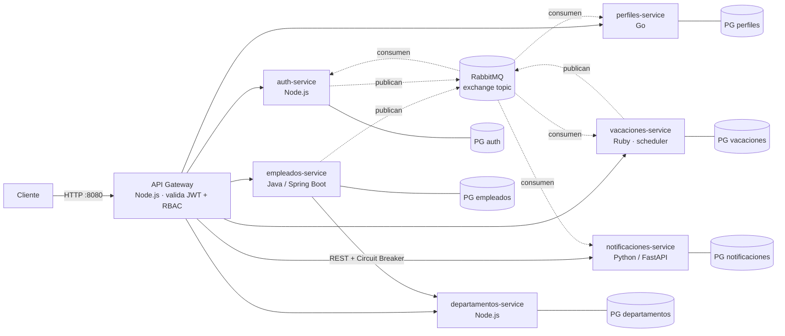

# Sistema de Gestión de Empleados — Arquitectura de Microservicios

Proyecto final del curso: automatiza el ciclo de vida del empleado de RRHH
(**onboarding → perfil → vacaciones → offboarding**) con 7 microservicios en
**5 lenguajes**, comunicación asíncrona por **RabbitMQ**, observabilidad
completa (logs, métricas, trazas y alertas) y CI en **Jenkins + SonarQube**.
Todo el sistema se despliega con un solo `docker compose up --build`.

| Documento | Contenido |
|---|---|
| [docs/arquitectura.md](docs/arquitectura.md) | Diagrama, componentes, decisiones y patrones (resiliencia, seguridad) |
| [docs/eventos.md](docs/eventos.md) | Eventos implementados, colas y deduplicación (normativo: [CATALOGO_EVENTOS.md](CATALOGO_EVENTOS.md)) |
| [docs/guias/](docs/guias/) | Configuración de herramientas de terceros: secretos, Jenkins/SonarQube, observabilidad, RabbitMQ |
| [e2e-tests/README.md](e2e-tests/README.md) | Suite funcional BDD (behave, Gherkin en español) |
| [docs/historial-retos.md](docs/historial-retos.md) | Bitácora técnica reto a reto (Retos 2 a 8) con evidencias |

---

## 1. Descripción del proyecto

### Qué resuelve

| Proceso | Cómo lo automatiza el sistema |
|---|---|
| **Onboarding** | RRHH crea el empleado → evento `empleado.creado` → auth crea la cuenta **inactiva y sin contraseña** y emite un token de activación con expiración → notificaciones genera la bienvenida con ese token → el empleado fija su contraseña con `POST /auth/reset-password`. El sistema **nunca genera ni transmite contraseñas**. |
| **Perfil** | Cada empleado autenticado actualiza **solo su propio** perfil (datos personales, contacto, foto, biografía, redes); intentar editar otro devuelve `403`. |
| **Vacaciones** | RRHH programa el período → un **scheduler** publica `vacaciones.iniciadas` / `vacaciones.finalizadas` → la cuenta se **suspende** al empezar y se **reactiva** al terminar, con notificación al empleado. |
| **Offboarding** | `DELETE /empleados/{id}` pasa el empleado a `RETIRADO` (no se borra, queda `fechaRetiro` para auditoría) → la cuenta se **desactiva permanentemente** y el perfil se archiva. |
| **Observabilidad** | Logs JSON centralizados en Loki, métricas en Prometheus + dashboard Grafana, trazas distribuidas en Zipkin (W3C Trace Context entre 5 lenguajes) y alertas a Telegram. |

### Arquitectura general



- **Único borde HTTP**: solo el gateway publica puerto al host (`:8080`); los
  servicios de negocio usan `expose` y no son alcanzables desde fuera.
- **Síncrono solo donde el enunciado lo pide**: cliente → gateway → servicios,
  y empleados → departamentos (validación de `departamentoId`, protegida con
  timeout, reintentos y Circuit Breaker con fallback).
- **Todo lo demás es asíncrono** por eventos, con envelope común y
  deduplicación por `id` en cada consumidor.
- **Una base de datos por servicio** (PostgreSQL 16), sin accesos cruzados.

Detalle completo: [docs/arquitectura.md](docs/arquitectura.md).

---

## 2. Requisitos previos

| Herramienta | Versión mínima | Nota |
|---|---|---|
| Docker Engine / Docker Desktop | 24+ / 4.25+ | En Windows/macOS asignar **≥ 6 GB** de RAM a Docker para el stack completo (app + observabilidad + CI) |
| Docker Compose | **v2.24+** | Usa `secrets` y las etiquetas `!override`/`!reset` |
| Bash | 4+ | Para `scripts/setup-secrets.sh`. En **Windows usar Git Bash** (el `bash` de PowerShell abre WSL) |
| curl (+ `jq` opcional) | — | Para los ejemplos de este README |

No hace falta instalar Java, Node, Go, Python ni Ruby: todo se compila dentro
de las imágenes (Dockerfiles multi-stage).

---

## 3. Instrucciones de ejecución

```bash
# 1. Descomprimir el proyecto y entrar en la carpeta
cd proyecto-final-microservicios

# 2. Generar la configuración local (una sola vez; idempotente)
cp .env.example .env              # opcional: el script lo crea si falta
bash scripts/setup-secrets.sh     # Windows: "C:\Program Files\Git\bin\bash.exe" scripts/setup-secrets.sh

# 3. Levantar todo el sistema
docker compose up --build
```

En un equipo con poca memoria se puede levantar por partes:

```bash
docker compose up -d --build api-gateway                    # app: gateway + 6 servicios + 6 BD + RabbitMQ
docker compose up -d prometheus grafana loki promtail zipkin # observabilidad
docker compose up -d jenkins sonarqube sonar-db registry     # CI
docker compose stop                                          # apagar sin borrar datos
```

### Acceso a los servicios

| Componente | URL | Credenciales |
|---|---|---|
| **API Gateway** | http://localhost:8080 | JWT (ver §5) |
| Swagger UI empleados | http://localhost:8080/empleados/swagger-ui.html | — |
| Swagger UI departamentos | http://localhost:8080/departamentos/api-docs | — |
| Swagger UI perfiles | http://localhost:8080/perfiles/docs | — |
| Swagger UI vacaciones | http://localhost:8080/vacaciones/docs | — |
| Swagger UI notificaciones | http://localhost:8080/notificaciones/docs | — |
| **Grafana** | http://localhost:3000 | §7 |
| **Prometheus** | http://localhost:9091 | — |
| **Zipkin** (trazas) | http://localhost:9411 | — |
| Loki (API, se consulta desde Grafana) | http://localhost:3100 | — |
| **RabbitMQ** Management | http://localhost:15672 | §7 |
| **Jenkins** | http://localhost:9090 | §7 |
| **SonarQube** | http://localhost:9000 | §7 |
| Docker Registry | http://localhost:5000/v2/_catalog | — |

> **Puertos que difieren del diagrama del enunciado**: Jenkins usa `9090`
> (contenedor `8080`) y por eso Prometheus se publica en `9091`, para no
> colisionar; el registry usa `5000`. auth-service sirve su OpenAPI en
> `/docs` dentro de la red (fuente: [auth-service/src/openapi.js](auth-service/src/openapi.js)).

Verificación rápida:

```bash
docker compose ps                         # servicios "healthy"
curl http://localhost:8080/health         # {"status":"UP","service":"api-gateway",...}
curl -i http://localhost:8080/empleados   # 401: sin token
```

---

## 4. Tecnologías utilizadas

### Microservicio ↔ lenguaje (5 lenguajes)

| Microservicio | Lenguaje / framework | Base de datos | Puerto interno |
|---|---|---|---|
| api-gateway | **Node.js 22** · Express 4 · http-proxy-middleware | — | 8080 (único publicado) |
| auth-service | **Node.js 22** · Express 4 · jsonwebtoken · bcryptjs | PostgreSQL `auth_db` | 8086 |
| departamentos-service | **Node.js 22** · Express 4 | PostgreSQL `departamentos` | 8082 |
| empleados-service | **Java 21** · Spring Boot 3.2 · Resilience4j | PostgreSQL `gestion_empleados` | 8081 |
| perfiles-service | **Go 1.26** · `net/http` · amqp091-go | PostgreSQL `perfiles` | 8083 |
| notificaciones-service | **Python 3.12** · FastAPI · SQLAlchemy · pika | PostgreSQL `notificaciones` | 8084 |
| vacaciones-service | **Ruby 3.3** · Sinatra · bunny (scheduler integrado) | PostgreSQL `vacaciones` | 8085 |

### Infraestructura

| Área | Herramienta |
|---|---|
| Message broker | **RabbitMQ 3** (exchange topic `ecosistema.eventos`, una cola durable por consumidor) |
| Bases de datos | **PostgreSQL 16** (una instancia por servicio) |
| Autenticación | Servicio propio (opción **a**): JWT HS256 firmado por auth-service, validado una sola vez en el gateway; contraseñas con BCrypt |
| Resiliencia | Resilience4j: timeout 2 s, 3 reintentos con backoff, Circuit Breaker con fallback `PENDIENTE_VALIDACION` |
| Logs centralizados | **Loki 2.9 + Promtail** (logs JSON con `timestamp`, `level`, `service`, `traceId`, `message`) |
| Métricas y dashboards | **Prometheus + Grafana** (dashboard aprovisionado como código) |
| Alertas | Grafana Alerting → **Telegram** ("Servicio Caído", "Alta Tasa de Errores") |
| Trazas | **OpenTelemetry** en los 7 servicios → **Zipkin 3**, propagación W3C `traceparent` por HTTP y por AMQP |
| CI | **Jenkins** (JCasC + Job DSL) · **SonarQube 9.9 LTS** (quality gate de cobertura ≥ 70 %) · Docker Registry local |
| Secretos | **Docker Compose secrets** + `.env` local (nunca en git) |
| Pruebas | JUnit/Testcontainers, `node:test`, pytest, `go test`, minitest; BDD con behave |

Justificación de Loki frente a ELK y de Zipkin frente a Jaeger:
[docs/guias/observabilidad.md](docs/guias/observabilidad.md).

---

## 5. Endpoints principales (API Gateway, `http://localhost:8080`)

| Método | Ruta | Descripción | Acceso |
|---|---|---|---|
| POST | `/auth/login` | Autenticación → `accessToken` | público |
| POST | `/auth/reset-password` | Fijar contraseña con token de activación o recuperación | público (token de un uso) |
| POST | `/auth/recover-password` | Solicitar recuperación (el token llega por notificación) | público |
| POST | `/auth/change-password` | Cambio de contraseña (actual + nueva) | autenticado |
| POST | `/auth/bootstrap` | Crea el ADMIN semilla; **solo funciona con la tabla de usuarios vacía** | público, una vez |
| GET | `/empleados` | Listar; `?estado=RETIRADO&desde=YYYY-MM-DD&hasta=YYYY-MM-DD` para auditoría | autenticado |
| POST | `/empleados` | Crear empleado (valida `departamentoId` contra departamentos) | ADMIN |
| GET | `/empleados/{id}` | Obtener empleado | autenticado |
| PUT | `/empleados/{id}` | Actualizar empleado | ADMIN |
| DELETE | `/empleados/{id}` | Retirar (transición a `RETIRADO`, no borrado) | ADMIN |
| GET | `/empleados/circuit/state` | Estado del Circuit Breaker | autenticado |
| GET / POST | `/departamentos` | Listar / crear departamentos | autenticado / ADMIN |
| GET | `/perfiles/{empleadoId}` | Obtener perfil | autenticado |
| PUT | `/perfiles/{empleadoId}` | Actualizar perfil (**solo el propio**; otro → `403`) | dueño o ADMIN |
| POST | `/vacaciones` | Programar vacaciones | ADMIN |
| GET | `/vacaciones` | Consultar vacaciones (`?empleadoId=`) | autenticado |
| GET | `/notificaciones/{empleadoId}` | Notificaciones enviadas a un empleado | autenticado |
| GET | `/health` | Salud del gateway | público |

Todos los servicios exponen además `GET /health` (estado propio + base de datos
y broker, `200`/`503`) y `GET /metrics` (Prometheus) dentro de la red.

### Ejemplos con curl

```bash
# Contraseña del ADMIN semilla: la eliges tú (≥ 8 caracteres, mayúscula,
# minúscula y número) y nunca se escribe en el repositorio.
read -s ADMIN_PASSWORD; export ADMIN_PASSWORD

# 0. Crear el ADMIN semilla (solo la primera vez, con la base vacía)
curl -X POST http://localhost:8080/auth/bootstrap -H 'Content-Type: application/json' \
  -d "{\"email\":\"admin@empresa.com\",\"password\":\"$ADMIN_PASSWORD\"}"

# 1. Login
TOKEN=$(curl -s -X POST http://localhost:8080/auth/login -H 'Content-Type: application/json' \
  -d "{\"email\":\"admin@empresa.com\",\"password\":\"$ADMIN_PASSWORD\"}" | jq -r .accessToken)
AUTH="Authorization: Bearer $TOKEN"

# 2. Departamento
curl -X POST http://localhost:8080/departamentos -H "$AUTH" -H 'Content-Type: application/json' \
  -d '{"id":"IT","nombre":"Tecnologia","descripcion":"Departamento de TI"}'

# 3. Onboarding: crear empleado (dispara empleado.creado)
curl -X POST http://localhost:8080/empleados -H "$AUTH" -H 'Content-Type: application/json' \
  -d '{"id":"E100","nombre":"Ana","apellido":"Gomez","email":"ana.gomez@empresa.com",
       "numeroEmpleado":"NUM-100","cargo":"Developer","area":"IT",
       "departamentoId":"IT","fechaIngreso":"2026-11-01"}'

# 4. Bienvenida con el token de activación (nunca una contraseña)
curl http://localhost:8080/notificaciones/E100 -H "$AUTH"

# 5. El empleado activa su cuenta con ese token
curl -X POST http://localhost:8080/auth/reset-password -H 'Content-Type: application/json' \
  -d '{"token":"<token-de-la-notificacion>","nuevaPassword":"<su-contraseña>"}'

# 6. Vacaciones (la cuenta se suspende al iniciar y se reactiva al terminar)
curl -X POST http://localhost:8080/vacaciones -H "$AUTH" -H 'Content-Type: application/json' \
  -d '{"empleadoId":"E100","fechaInicio":"2026-12-15","fechaFin":"2026-12-30"}'

# 7. Offboarding y consulta de auditoría
curl -X DELETE http://localhost:8080/empleados/E100 -H "$AUTH"
curl "http://localhost:8080/empleados?estado=RETIRADO&desde=2026-11-01&hasta=2026-12-31" -H "$AUTH"
```

Más escenarios (Circuit Breaker, deduplicación, caos): [docs/historial-retos.md](docs/historial-retos.md).

---

## 6. Configuración inicial y secretos

**Ningún secreto vive en el repositorio**: ni en el código ni en
`docker-compose.yml`, y ningún secreto real pasó por el historial (los únicos
valores que aparecen en commits antiguos son contraseñas de demostración de
stacks desechables, retiradas en el Proyecto Final; ver
[guía de secretos](docs/guias/secretos.md)). El repositorio solo trae
plantillas: [.env.example](.env.example) y [secrets.example/](secrets.example/).
`.env` y `secrets/` están en `.gitignore`.

### Generación

`bash scripts/setup-secrets.sh` crea `.env` (si falta) y la carpeta
`secrets/` con valores aleatorios de 64 caracteres. Es idempotente: no pisa lo
que ya existe. Nunca imprime los valores.

### Qué configura cada cosa

| Origen | Variable / archivo | Uso |
|---|---|---|
| `secrets/jwt_secret` | Docker secret → `JWT_SECRET_FILE` | Firma (auth-service) y validación (gateway) de los JWT; credencial `jwt-secret` de Jenkins |
| `secrets/db_<servicio>_password` (6) | Docker secret → `POSTGRES_PASSWORD_FILE` y `DB_PASSWORD_FILE` | Contraseña de cada PostgreSQL y de su servicio |
| `secrets/grafana_admin_password` | Docker secret → `GF_SECURITY_ADMIN_PASSWORD__FILE` | Admin de Grafana |
| `secrets/jenkins_admin_password` | Docker secret → `jenkins/init.groovy.d/create-admin.groovy` | Admin de Jenkins |
| `.env` → `RABBITMQ_USER` / `RABBITMQ_PASSWORD` | variable obligatoria | RabbitMQ (la imagen no admite `*_FILE`) |
| `.env` → `SONAR_DB_PASSWORD` | variable obligatoria | PostgreSQL de SonarQube |
| `.env` → `SONAR_TOKEN` | manual | Token de análisis de SonarQube para Jenkins ([guía](docs/guias/jenkins-sonarqube.md)) |
| `.env` → `TELEGRAM_BOT_TOKEN` / `TELEGRAM_CHAT_ID` | manual, opcional | Canal de alertas ([guía](docs/guias/observabilidad.md)) |
| `.env` → `DB_*_NAME`, `DB_*_USER`, `GRAFANA_ADMIN_USER` | con valores por defecto | Nombres y usuarios (no son secretos) |

Cada servicio lee `NOMBRE_FILE` (archivo montado en `/run/secrets`) y, si no
existe, la variable `NOMBRE`; nunca usa un valor fijo en el código. Si falta
una variable obligatoria, `docker compose` se detiene con el mensaje
"ejecuta bash scripts/setup-secrets.sh".

### Rotación

```bash
bash scripts/setup-secrets.sh --rotate   # regenera TODOS los secretos
```

- **JWT**: rota en caliente con
  `docker compose up -d --force-recreate api-gateway auth-service jenkins`
  (los tokens ya emitidos dejan de valer).
- **PostgreSQL, RabbitMQ, Grafana, Jenkins**: guardan la contraseña al crear su
  volumen. Tras rotar, recrear los volúmenes (`docker compose down -v`, borra
  datos) o cambiarla dentro de cada uno (`ALTER USER ...`,
  `rabbitmqctl change_password`, `grafana cli admin reset-admin-password`).

Detalle y diseño (incluido cómo se inyectan en CI): [docs/guias/secretos.md](docs/guias/secretos.md).

---

## 7. Accesos por defecto

### Usuario administrador semilla

No hay usuarios precargados ni endpoint público de registro. El primer ADMIN se
crea **una sola vez** con `POST /auth/bootstrap` (§5, paso 0), que solo
responde mientras la tabla de usuarios está vacía; después devuelve `400`.
La contraseña la elige quien despliega y se guarda hasheada con BCrypt. El
resto de cuentas las crea el sistema al consumir `empleado.creado`.

### Herramientas

| Herramienta | Usuario | Contraseña |
|---|---|---|
| Grafana | `admin` (`GRAFANA_ADMIN_USER`) | archivo `secrets/grafana_admin_password` |
| Jenkins | `admin` | archivo `secrets/jenkins_admin_password` |
| RabbitMQ Management | `RABBITMQ_USER` del `.env` | `RABBITMQ_PASSWORD` del `.env` |
| SonarQube | `admin` | la imagen arranca con su contraseña de fábrica y **obliga a cambiarla en el primer ingreso**; no se guarda en el repo |
| Prometheus, Zipkin, Registry | — | sin autenticación (solo `localhost`) |

Para ver un secreto localmente: `cat secrets/grafana_admin_password`
(PowerShell: `Get-Content secrets\grafana_admin_password`).

---

## Estructura del repositorio

```
.
├── README.md                  # este documento
├── docker-compose.yml         # orquestación completa (app + observabilidad + CI)
├── docker-compose.e2e.yml     # override del stack E2E de Jenkins
├── .env.example               # plantilla de variables (el .env real no se versiona)
├── secrets.example/           # plantillas de los archivos de secretos
├── CATALOGO_EVENTOS.md        # contrato normativo de eventos
├── api-gateway/  auth-service/  departamentos/  empleados/
├── perfiles/  notificaciones/  vacaciones/    # un microservicio por carpeta (Dockerfile, src, tests, OpenAPI)
├── e2e-tests/                 # suite funcional BDD (behave)
├── observability/             # Prometheus, Grafana (datasources, dashboards, alertas), Loki, Promtail
├── jenkins/                   # imagen, JCasC (casc.yaml) y scripts de arranque
├── scripts/                   # setup-secrets.sh, ci-compose.sh, utilidades de CI
├── docs/                      # arquitectura, eventos, guías, historial de retos
└── evidencias/                # logs y capturas de cada reto
```

Pipelines de CI: [empleados/Jenkinsfile](empleados/Jenkinsfile) y
[vacaciones/Jenkinsfile](vacaciones/Jenkinsfile) (Checkout → Build → Test →
SonarQube + Quality Gate → Package → E2E). Guía:
[docs/guias/jenkins-sonarqube.md](docs/guias/jenkins-sonarqube.md).
