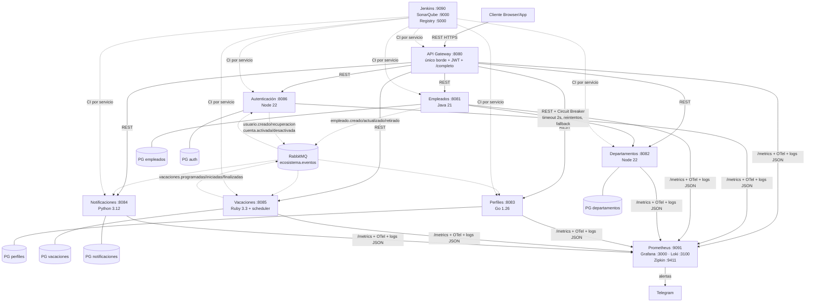

# Arquitectura del Sistema

## Diagrama

Red única `microservices-network` (decisión: segmentación por capas del diagrama
de referencia no aporta aislamiento real sin políticas; un solo compose
despliega todo con `docker compose up --build`).

## Decisiones

- **Borde único**: solo el gateway publica puerto HTTP (:8080). Auth en :8086,
  resto 8081–8085 internos (`expose`). Sin `/register` público: las cuentas
  nacen del evento `empleado.creado`, inactivas y sin contraseña (BCrypt solo al
  establecerla el empleado con token de 30 min).
- **Auth opción (a)**: JWT propio HS256 con secreto compartido gateway+auth
  (fail-fast si falta). Sin IdP externo.
- **Resiliencia**: empleados→departamentos con timeout (2s), reintentos con
  backoff y Circuit Breaker con fallback (`PENDIENTE_VALIDACION`) + endpoint
  observable `GET /empleados/circuit/state`. Servicios stateless; el scheduler
  de vacaciones es de instancia única documentada.
- **Agregado opcional**: `GET /empleados/:id/completo` (gateway, con código)
  combina empleado+perfil; si perfiles cae responde 200 degradado
  (`perfil: null, degradado: true`) con timeout de 2.5s. Los gateways
  declarativos no componen: por eso el gateway es Express con código propio.
- **Eventos**: envelope común + deduplicación obligatoria por `id` + W3C por
  cabeceras AMQP (ver `docs/eventos.md`). Traza de onboarding verificada:
  51 spans, 7 servicios, un `traceId`.
- **Observabilidad**: Prometheus (scrape 15s, 7 jobs) + Grafana aprovisionado
  (datasources, dashboard ecosistema, 2 reglas, contact point Telegram) +
  Loki/Promtail (logs JSON con `traceId`) + Zipkin. Límite hallado: Grafana
  rechaza `chat_id` numérico por `$VAR` (infiere número); el repo trae template
  y `scripts/grafana-set-telegram.py` genera el fichero con valores citados.
- **Salud**: `GET /health` → `{"status":"UP|DOWN","service":"...","checks":
  {"database":"UP|DOWN","messageBroker":"UP|DOWN"}}` (200/503). Gateway y
  departamentos reportan `N/A` donde no tienen dependencia propia (sin broker
  cliente): honesto y documentado; su `DOWN` lo gobierna lo que sí usan.
- **Cobertura**: mínimo 70% con gate en pipeline (nativo donde se puede,
  Quality Gate SonarQube en todos). Perfiles mide alcance unitario
  (fuera `cmd/` y `store/postgres/`, que exigen runtime vivo y los cubre el
  BDD contra el stack desplegado).
- **Docker**: multistage donde hay compilación (Java, Go, Ruby); Node/Python
  single-stage optimizado (`--omit=dev`, cache de capas, `.dockerignore`).
- **Secretos**: cero en git (`.env` + `secrets/` ignorados, `.env.example` con
  las 26 variables, `scripts/setup-secrets.sh` genera JWT). Rotación: regenerar
  con el script y recrear contenedores; el JWT invalida todos los tokens.
- **CI**: un `Jenkinsfile` por servicio (Checkout/Build/Test/SonarQube con
  `qualitygate.wait`/Package al registry/E2E); tests rojos → UNSTABLE o
  FAILURE, cobertura <70% o QG rojo → FAILURE.
