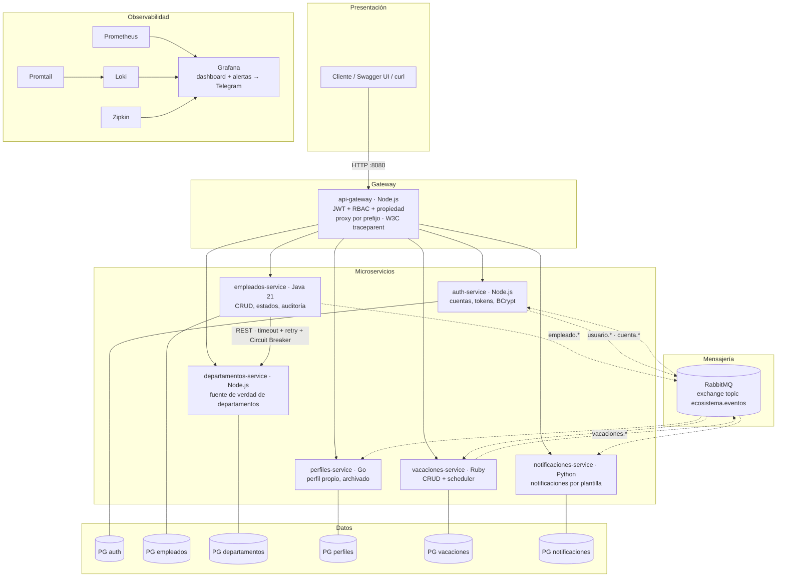
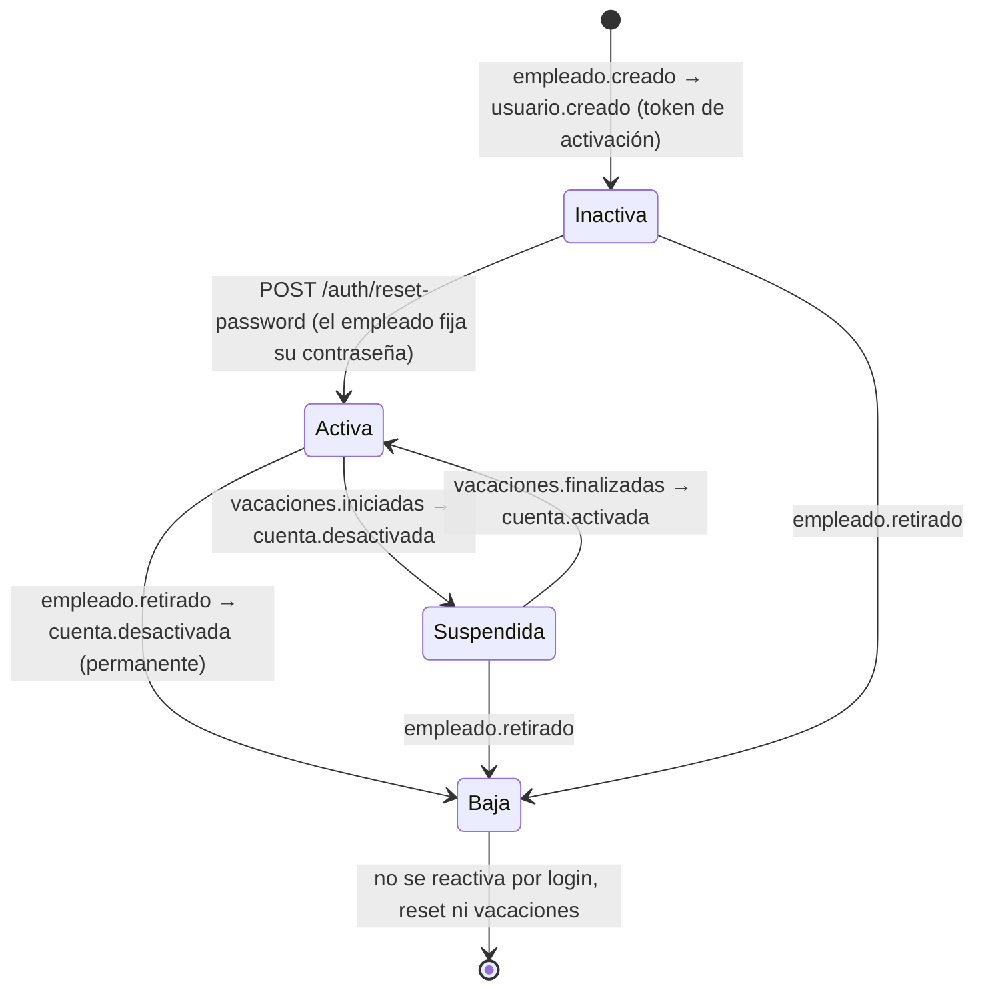

# Arquitectura del sistema

Volver al [README](../README.md) · Eventos: [eventos.md](eventos.md) · Guías: [guias/](guias/)

## 1. Vista general

Líneas sólidas: comunicación síncrona (HTTP). Líneas punteadas: eventos.

## 2. Componentes

| Componente | Responsabilidad | Estado propio |
|---|---|---|
| **api-gateway** | Único punto de entrada. Valida el JWT una vez (HS256), aplica RBAC (ADMIN escribe, USER lee) y la regla de propiedad (`PUT /perfiles/{id}` solo el propio), reenvía por prefijo, propaga el contexto de traza. No tiene lógica de negocio. | ninguno |
| **auth-service** | Cuentas de acceso: las crea al consumir `empleado.creado` (inactivas, sin contraseña), emite token de activación/recuperación con expiración, login, cambio y recuperación de contraseña, suspensión temporal (vacaciones) y baja permanente (retiro). Sin endpoint de registro público. | `usuarios`, `eventos_procesados` |
| **empleados-service** | CRUD de empleados con estados `ACTIVO`, `EN_VACACIONES`, `RETIRADO` (y `PENDIENTE_VALIDACION` en fallback); unicidad de `email` y `numeroEmpleado`; retiro como transición con `fechaRetiro`; consulta de auditoría por rango; publica `empleado.*`. | `empleados` |
| **departamentos-service** | CRUD de departamentos; fuente de verdad que empleados consulta por REST. | `departamentos` |
| **perfiles-service** | Perfil complementario (foto, biografía, redes, dirección); creado y sincronizado por eventos; archivado al retiro. | `perfiles`, `eventos_procesados` |
| **vacaciones-service** | CRUD de períodos con validaciones (fechas coherentes, no pasadas, sin solapamiento, empleado existente en réplica local); scheduler que publica inicio y fin. | `vacaciones`, `empleados_locales` |
| **notificaciones-service** | Consume 9 tipos de evento y genera la notificación por plantilla (bienvenida con token, vacaciones, cambios de cuenta, desvinculación). Canal actual: la notificación se registra en su base de datos y se consulta por API (correo simulado). | `notificaciones`, `eventos_procesados` |

## 3. Comunicación

### Síncrona (REST)

Solo cliente → gateway → servicios, y **empleados → departamentos** para
validar `departamentoId` al crear un empleado (si no existe: `400`). Es el
único punto síncrono entre microservicios y por eso concentra los patrones de
resiliencia:

| Patrón | Configuración | Implementación |
|---|---|---|
| Timeout | 2 s de conexión y de lectura | `DepartamentoRestClient` |
| Reintentos | 3 reintentos con backoff 1 s, 2 s, 4 s; solo ante errores de red y 5xx (un 404 es respuesta de negocio) | `DepartamentoRestClient` |
| Circuit Breaker | ventana de 5 llamadas, umbral 50 %, 30 s en OPEN, 1 llamada de prueba en HALF_OPEN | Resilience4j (`DepartamentoCircuitBreaker`) |
| Fallback | con el circuito abierto el empleado se acepta como `PENDIENTE_VALIDACION`; `POST /empleados/{id}/revalidar` lo reconcilia | `EmpleadoService` |

Estado observable en `GET /empleados/circuit/state`. Prueba reproducible paso a
paso: [historial-retos.md § Circuit Breaker](historial-retos.md#4-circuit-breaker).

### Asíncrona (eventos)

RabbitMQ con un exchange topic durable (`ecosistema.eventos`); routing key =
tipo del evento; una cola durable por servicio consumidor; ACK manual después
de persistir el efecto; deduplicación por `id` del envelope. Detalle en
[eventos.md](eventos.md).

## 4. Ciclo de vida de la cuenta

## 5. Seguridad

- **JWT HS256** firmado por auth-service con un secreto compartido que solo
  conocen auth-service y el gateway (Docker secret). El gateway valida firma,
  expiración y tipo de token; los tokens de activación/recuperación (`type:
  RESET_PASSWORD`) nunca sirven como token de acceso.
- **RBAC y propiedad** en el borde; `401` sin token, `403` sin permiso.
- **Contraseñas**: BCrypt; nunca se generan, ni se envían por correo o eventos.
- **Superficie expuesta**: solo el gateway publica puerto de aplicación; los
  servicios usan `expose`.
- **Secretos**: Docker Compose secrets + `.env` local; ver
  [guias/secretos.md](guias/secretos.md).

## 6. Observabilidad

| Señal | Cómo | Dónde |
|---|---|---|
| Logs | JSON estructurado (`timestamp`, `level`, `service`, `traceId`, `message`) a stdout; Promtail los recoge por el socket de Docker | Loki → Grafana Explore |
| Métricas | `GET /metrics` en cada servicio (RED: peticiones, errores, latencia; eventos publicados; transiciones del scheduler) | Prometheus → dashboard "Reto 8 — Ecosistema" |
| Trazas | OpenTelemetry en los 7 servicios, exportador Zipkin, propagación W3C `traceparent` en HTTP y en las cabeceras AMQP | Zipkin (traza completa del onboarding: gateway → empleados → broker → auth/perfiles/notificaciones) |
| Alertas | Reglas Grafana "Servicio Caído" y "Alta Tasa de Errores" | Telegram |

Guía: [guias/observabilidad.md](guias/observabilidad.md).

## 7. Despliegue

Un solo `docker-compose.yml` levanta 23 contenedores: 7 microservicios, 6
PostgreSQL, RabbitMQ, Prometheus, Grafana, Loki, Promtail, Zipkin, Jenkins,
SonarQube + su PostgreSQL y el registry local. Imágenes multi-stage donde hay
compilación (Java, Go, Ruby), healthchecks en servicios y bases de datos, y
volúmenes persistentes por base de datos, broker, Jenkins, SonarQube, Grafana,
Prometheus y Loki.

## 8. Decisiones principales

| Decisión | Alternativas | Motivo |
|---|---|---|
| Gateway propio en Express | Traefik, Kong, Spring Cloud Gateway | Hace falta lógica (JWT, RBAC, propiedad, propagación de identidad); un gateway declarativo no la tiene y Spring Cloud Gateway duplicaba el peso de una JVM |
| RabbitMQ | Kafka, NATS, Redis Streams | Fan-out con exchange topic y cola durable por consumidor sin código extra; UI de administración; un solo contenedor |
| Réplica local de empleados en vacaciones | Consultar empleados por REST | Mantiene la comunicación entre microservicios asíncrona; costo aceptado: consistencia eventual |
| Fallback `PENDIENTE_VALIDACION` | Rechazar con 503 | RRHH no se detiene si departamentos cae; se reconcilia explícitamente |
| Auth propio (opción a) | Keycloak (opción b) | Alcance del curso; el gateway ya concentra la validación y facilita migrar a JWKS |
| Loki y Zipkin | ELK, Jaeger | Integración nativa con Grafana y menor consumo de memoria ([guía](guias/observabilidad.md)) |
