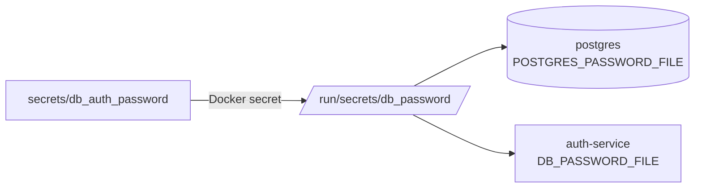

# Guía: gestión de secretos

Volver al [README](../../README.md#6-configuración-inicial-y-secretos)

## Principio

El repositorio debe poder publicarse como código abierto en cualquier momento.
Por eso **ningún valor secreto** está en el código, en `docker-compose.yml` ni
en `.env.example`: solo hay nombres de variables y plantillas.

| Versionado | No versionado (`.gitignore`) |
|---|---|
| `.env.example` (variables con valores vacíos o no secretos) | `.env` |
| `secrets.example/` (un archivo de muestra por secreto) | `secrets/` |
| `scripts/setup-secrets.sh` | `e2e-tests/.e2e-admin-password` (efímera de CI) |

## 1. Primer uso

```bash
bash scripts/setup-secrets.sh
```

En Windows con PowerShell, `bash` abre WSL; usar Git Bash:

```powershell
& "C:\Program Files\Git\bin\bash.exe" scripts/setup-secrets.sh
```

El script:

1. Copia `.env.example` a `.env` si no existe.
2. Crea `secrets/` con un archivo por secreto: 64 caracteres hexadecimales
   aleatorios (`openssl rand -hex 32`, o `/dev/urandom` si no hay openssl).
3. Completa en `.env` las contraseñas de imágenes que no admiten `*_FILE`
   (`RABBITMQ_PASSWORD`, `SONAR_DB_PASSWORD`) si están vacías.
4. **Migración**: si un secreto aún no tiene archivo pero un `.env` antiguo
   traía su valor (`JWT_SECRET`, `DB_*_PASSWORD`), reutiliza ese valor y lo
   quita del `.env`, para que los volúmenes ya creados sigan funcionando.

Es idempotente (no pisa archivos existentes) y nunca imprime los valores.

## 2. Cómo llegan a los contenedores



| Secreto | Contenedores | Variable que lo apunta |
|---|---|---|
| `jwt_secret` | auth-service, api-gateway, jenkins | `JWT_SECRET_FILE` (Jenkins: JCasC lee `/run/secrets/JWT_SECRET`) |
| `db_<servicio>_password` | su PostgreSQL y su servicio | `POSTGRES_PASSWORD_FILE` / `DB_PASSWORD_FILE` |
| `grafana_admin_password` | grafana | `GF_SECURITY_ADMIN_PASSWORD__FILE` |
| `jenkins_admin_password` | jenkins | leído por `jenkins/init.groovy.d/create-admin.groovy` |

Convención de lectura en los servicios (igual en los 5 lenguajes): si existe
`NOMBRE_FILE` se lee ese archivo; si no, la variable `NOMBRE`; si no hay
ninguna, valor vacío y el servicio falla al conectar. **Nunca hay un valor
fijo en el código.**

| Lenguaje | Dónde |
|---|---|
| Node.js (gateway, auth, departamentos) | `src/config/secrets.js` (`readSecret`) |
| Java (empleados) | `spring.config.import=optional:configtree:/run/secrets/` en `application.properties`: el archivo `/run/secrets/DB_PASSWORD` se vuelve la propiedad `DB_PASSWORD` |
| Go (perfiles) | `internal/config/config.go` (`getsecret`) |
| Python (notificaciones) | `app/config.py` (`_secret`) |
| Ruby (vacaciones) | `app/config.rb` (`Config.secret`) |

RabbitMQ y SonarQube no admiten `*_FILE`, así que sus contraseñas van en
`.env` como variables **obligatorias**: `docker compose` se detiene si faltan.

## 3. Secretos en CI (Jenkins)

Jenkins lanza el stack E2E con el Docker del host a través del socket. Un
secreto de tipo `file:` sería un *bind mount* de una ruta del workspace de
Jenkins que el host no ve. Por eso:

- `docker-compose.e2e.yml` redefine cada secreto con `environment:` (Compose
  copia el valor dentro del contenedor, sin montar nada).
- `scripts/ci-compose.sh` genera un valor aleatorio para cada contraseña que
  falte, en cada invocación: el stack E2E es desechable y se borra con
  `down -v`.
- `JWT_SECRET` llega de la credencial `jwt-secret` de Jenkins.
- El ADMIN del stack E2E se crea con una contraseña efímera generada por
  `scripts/wait-for-e2e-ready.py`; los usuarios sintéticos de la suite BDD
  también usan una contraseña aleatoria por corrida.

## 4. Rotación

```bash
bash scripts/setup-secrets.sh --rotate
```

| Secreto | Cómo aplicar el valor nuevo |
|---|---|
| `jwt_secret` | `docker compose up -d --force-recreate api-gateway auth-service jenkins` (los tokens emitidos dejan de valer) |
| `db_*_password` | PostgreSQL guarda la contraseña al crear el volumen: `docker compose exec database-auth psql -U postgres -c "ALTER USER postgres PASSWORD '<nuevo>'"` y recrear el servicio, o `docker compose down -v` (borra datos) |
| `RABBITMQ_PASSWORD` | `docker compose exec message-broker rabbitmqctl change_password admin '<nuevo>'` y recrear los servicios |
| `grafana_admin_password` | `docker compose exec grafana grafana cli admin reset-admin-password "$(cat secrets/grafana_admin_password)"` |
| `jenkins_admin_password` | reiniciar Jenkins (`create-admin.groovy` aplica el valor del secreto) |

## 5. Historial de git

Los secretos reales (claves JWT, contraseñas de base de datos, contraseñas
de administración) **nunca** se versionaron. En commits de retos anteriores
aparecen contraseñas **de demostración** de stacks desechables (cuenta ADMIN de
prueba de la suite E2E). En el Proyecto Final se retiraron del código y se
reemplazaron por valores efímeros. Para auditar el estado actual:

```bash
git grep -nE "PASSWORD\s*[:=]\s*['\"]?[A-Za-z0-9]{6,}" -- . ':!*.lock'
```
