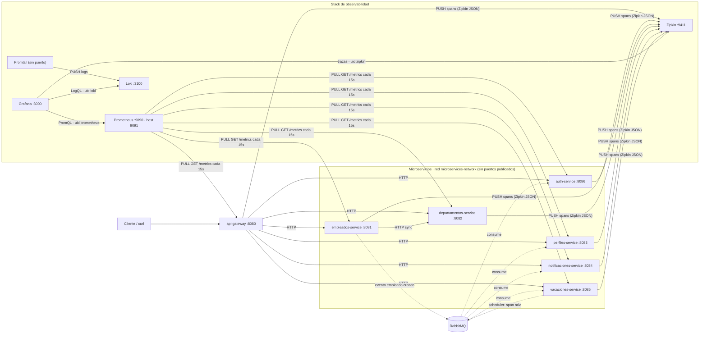

# Historial de retos (bitácora técnica)

> Este documento es el registro **reto a reto** de cómo se construyó el sistema
> (decisiones, evidencias y pruebas de cada entrega, del Reto 2 al Reto 8).
> Está agrupado por reto y conserva el texto original de cada entrega, por eso algunos datos quedaron superados por retos posteriores
> (p. ej. credenciales `admin/admin` o `JWT_SECRET` en `.env`, reemplazados por
> Docker secrets en el Proyecto Final).
>
> **La documentación vigente está en el [README](../README.md)**, en
> [arquitectura](arquitectura.md), [eventos](eventos.md) y [guías](guias/).

---

# Reto 6 — Automatización de Pruebas (pirámide completa y reportes para Jenkins)

Evolución del Reto 5: misma funcionalidad, con una estrategia de pruebas en
tres niveles que produce reportes estándar listos para Jenkins/Sonar del
Reto 7. La URL base única sigue siendo **`http://localhost:8080`**; el
detalle técnico de la suite E2E vive en
[`e2e-tests/README.md`](../e2e-tests/README.md).

## 1. Pirámide: distribución entre niveles

| Nivel | Suite | Qué cubre | Verificado |
|---|---|---|---|
| Unitarias + integración | `empleados` — JUnit 5 + Mockito + Testcontainers | reglas de negocio, validaciones, eventos, circuit breaker y repositorio contra **PostgreSQL 16 real** | **87 tests**, 0 fallos; JaCoCo **84,06 %** líneas (269/320) |
| Unitarias + integración | `vacaciones` — Minitest (stdlib) | validaciones de períodos/solapamiento, endpoints, consumer/publisher | **70 runs**, 297 assertions, 0 fallos; **75,36 %** líneas (260/345) |
| E2E BDD (cúspide) | `e2e-tests` — Behave + requests | flujos completos por el **gateway**: humo, RBAC, onboarding asíncrono, vacaciones y offboarding | **5 features / 18 escenarios / 116 steps**, 0 fallos en 3 corridas consecutivas |

La base protege la lógica fina sin infraestructura; la integración usa el
PostgreSQL real porque H2 miente en constraints y sintaxis; la cúspide BDD
valida el sistema **desplegado** y la asincronía real (RabbitMQ, scheduler,
polling) que ninguna unitaria ve.

## 2. Contrato de reportes (Jenkins/Sonar — Reto 7)

| Suite | Comando único | Reporte de resultados | Reporte de cobertura |
|---|---|---|---|
| empleados | `cd empleados && mvn test` | `empleados/target/surefire-reports/TEST-*.xml` | `empleados/target/site/jacoco/jacoco.xml` (+ `index.html`) |
| vacaciones | `cd vacaciones && ruby tests/run_all.rb` | `vacaciones/reports/junit.xml` | `vacaciones/reports/coverage/coverage.json` (+ `index.html`) |
| E2E BDD | `cd e2e-tests && ./run_bdd.sh` | `e2e-tests/reports/TESTS-*.xml` | `e2e-tests/reports/cucumber.json` + `cucumber.html` |

`target/`, `reports/` y `coverage/` están en `.gitignore`: Jenkins los archiva
como artefactos del build, nunca se versionan. `run_bdd.sh` propaga el exit
code de Behave (0 verde / 1 fallo), por eso sirve como gate de CI.

## 3. Prerequisitos y ejecución

Requisitos: Docker + Compose (stack de 14 contenedores), Java 21 + Maven 3.9,
Ruby 3.3 sin gemas, Python 3.11 con el venv de `e2e-tests/` (`behave`,
`requests`, `behave-html-formatter`).

```bash
# a) Stack desplegado (una vez, desde la raíz)
docker compose up --build -d
curl http://localhost:8080/health                # 200 {"status":"ok","service":"api-gateway"}
#    stack nuevo: crear el primer ADMIN con /auth/bootstrap (Reto 5 § "Cómo obtener un token")

# b) Un comando por suite (desde la raíz)
(cd empleados  && mvn test)                      # 87 tests + surefire + JaCoCo
(cd vacaciones && ruby tests/run_all.rb)         # 70 runs + junit + coverage
(cd e2e-tests  && python3.11 -m venv .venv \
                && .venv/bin/pip install -r requirements.txt \
                && ./run_bdd.sh)                 # 18 escenarios + junit + cucumber json/html

# c) Reportes: rutas exactas en la tabla §2 (gitignored)
```

`run_bdd.sh` usa por defecto `BASE_URL=http://localhost:8080` y las
credenciales ADMIN del bootstrap de demo; se sobreescriben por entorno
(desde `e2e-tests/`):

```bash
ADMIN_EMAIL=otro@empresa.com ADMIN_PASSWORD=... ./run_bdd.sh
```

## 4. BDD: qué es, por qué y escenarios cubiertos

BDD (Behavior-Driven Development) escribe la prueba como comportamiento
observable en lenguaje natural: Gherkin (`Característica > Escenario >
Dado/Cuando/Entonces`) en español (`# language: es`). El `.feature` es a la
vez la especificación y la prueba; los pasos se implementan en Python.

Se eligió **Behave + requests** (alternativas: pytest-bdd, Robot Framework,
Cucumber-JVM) porque el equipo ya usa Python, Gherkin `es` es nativo,
`requests` hace trivial el polling asíncrono y Behave trae formatters JUnit
XML / Cucumber JSON de fábrica (HTML con `behave-html-formatter`). Cubre 18
escenarios: humo (1), RBAC (4), onboarding asíncrono (5), vacaciones y
scheduler (4), offboarding (4). No se añadió un contenedor `bdd-tests` al
compose (el PDF lo marca opcional): la suite corre contra el stack levantado
y se evaluará dockerizarla en el Reto 7 solo si el pipeline lo exige.

---

# Reto 5 — Seguridad y Control de Acceso con JWT (evolución del Reto 4)

Evolución del Reto 4 (comunicación asincrónica por eventos): el sistema suma
**autenticación y autorización con JWT**. El `api-gateway` valida el token en el único
borde HTTP; los 5 servicios de negocio pasan de públicos a protegidos sin código JWT
propio; entra en vigor RBAC; el nuevo `auth-service` conduce el ciclo de vida de
cuentas.

**URL base vigente: `http://localhost:8080`** (única publicada al host, como en Reto 3).

## 1. Arquitectura (14 contenedores)

| Servicio | Lenguaje | Puerto interno | Puerto host |
|---|---|---|---|
| api-gateway | Node.js 22 + Express 4 | 8080 | **8080 (el único HTTP)** |
| auth-service (nuevo) | Node.js 22 + Express 4 | 8086 | ninguno (`expose`) |
| empleados-service | Java 21 + Spring Boot 3 | 8081 | ninguno |
| departamentos-service | Node.js 22 + Express 4 | 8082 | ninguno |
| perfiles-service | Go 1.26 (stdlib net/http) | 8083 | ninguno |
| notificaciones-service | Python + FastAPI (9 claves de entorno) | 8084 | ninguno |
| vacaciones-service | Ruby + Sinatra (scheduler integrado) | 8085 | ninguno |
| databases + `database-auth` (nueva, BD `auth_db`) | postgres:16-alpine | 5432 | ninguno |
| message-broker | RabbitMQ 3 + management | 5672 / 15672 | **5672 y 15672** |

14 en total: gateway + auth + 5 servicios de negocio + 6 postgres + rabbitmq. Solo
`:8080` como borde HTTP al host; 5672 (AMQP) y 15672 (UI) son exclusivos del broker.

## 2. Rutas del Gateway: nuevas de auth; negocio ahora protegido

| Ruta | Acceso | Destino |
|---|---|---|
| `POST /auth/bootstrap` | pública (solo si aún no hay ADMIN) | auth-service |
| `POST /auth/login` | pública | auth-service |
| `POST /auth/recover-password` | pública | auth-service |
| `POST /auth/reset-password` | pública (token de un uso) | auth-service |
| `POST /auth/change-password` | protegida (propio usuario) | auth-service |
| `GET/POST /empleados`, `/empleados/*` | **protegida** | :8081 |
| `GET/POST /departamentos`, `/departamentos/*` | **protegida** | :8082 |
| `GET/POST /perfiles`, `/perfiles/*` | **protegida** (propiedad en `PUT /perfiles/{id}`) | :8083 |
| `GET /notificaciones`, `/notificaciones/*` | **protegida** | :8084 |
| `GET/POST /vacaciones`, `/vacaciones/*` | **protegida** | :8085 |
| `GET /health` | pública | gateway |

Las 5 rutas de negocio del Reto 3 se enrutan igual; solo pasan de públicas a protegidas (`503`/`404` intactos).

## 3. Variables de entorno nuevas

| Variable | Dónde | Nota |
|---|---|---|
| `JWT_SECRET` | auth-service **y** api-gateway (misma clave) | Docker secret `secrets/jwt_secret` (lo genera `scripts/setup-secrets.sh`); nunca en `.env` ni en git |
| `AUTH_URL` | api-gateway | `http://auth-service:8086` |
| `SCHEDULER_INTERVAL_S` | vacaciones-service | segundos entre corridas del scheduler (default `60` = 1 minuto) |

## 4. Cómo obtener un token

```bash
# ADMIN_PASSWORD: la eliges tú (≥ 8 caracteres, mayúscula, minúscula y número)
# y nunca se escribe en el repositorio. Ej.: read -s ADMIN_PASSWORD; export ADMIN_PASSWORD
# una sola vez: crea el primer ADMIN
curl -X POST http://localhost:8080/auth/bootstrap -H 'Content-Type: application/json' \
  -d "{\"email\":\"admin@empresa.com\",\"password\":\"$ADMIN_PASSWORD\"}"

# login (emitir/renovar JWT)
ADMIN_TOKEN=$(curl -s -X POST http://localhost:8080/auth/login -H 'Content-Type: application/json' \
  -d "{\"email\":\"admin@empresa.com\",\"password\":\"$ADMIN_PASSWORD\"}" | jq -r .token)

# usar el token en negocios
curl http://localhost:8080/empleados -H "Authorization: Bearer $ADMIN_TOKEN"
```

Sin token: `401 {"error":"Token faltante o inválido"}`. Sin permiso: `403 {"error":"No tiene permisos para esta operación"}`.

## 5. Estrategia de validación: solo el gateway (una vez)

El gateway valida firma y expiración del JWT **una única vez** en el borde, sin
duplicar la misma lógica JWT en 4 lenguajes; prepara el Reto 10 (JWKS asimétrico).

## 6. RBAC + reglas de propiedad

| Rol | Alcance |
|---|---|
| ADMIN | todo: gestión de todos los recursos, bootstrap, consultas globales (vacaciones, notificaciones, departamentos) |
| USER | `GET` de recursos + `PUT /perfiles/{id}` **solo si es el propio** + `POST /auth/change-password` **solo para sí mismo** |

`403` cuando el rol no alcanza o la propiedad falla; se compara el `userId` del JWT con
el recurso pedido.

## 7. Scheduler del ciclo de vida (vacaciones-service)

Cada `SCHEDULER_INTERVAL_S` segundos (default `60`, 1 minuto): `PROGRAMADA → EN_CURSO`
cuando `fechaInicio <= hoy`; `EN_CURSO → FINALIZADA` cuando `fechaFin <= hoy` (fin
**inclusivo**). Demo: período `hoy–hoy` se inicia y termina con 2 corridas. Idempotente:
`UPDATE ... WHERE <estado previo> ... RETURNING id` (eventos solo por filas cambiadas).
Limitación: con **N instancias** habría eventos duplicados → se propone **ShedLock** (Reto 31).

## 8. Ciclo de vida de la cuenta (vista por eventos)

```text
empleado.creado ─► auth consume ─► usuario.creado (inactivo)
                 └─► recover/reset (token de un uso) ─► reset-password ─► activo
login (JWT) ─► uso de negocios protegidos
vacaciones.iniciadas ─► cuenta.desactivada
vacaciones.finalizadas ─► cuenta.activada
empleado.retirado ─► cuenta.desactivada (PERMANENTE)
EDGE: la cuenta retirada NO se reactiva (ni por login, ni por reset, ni re-contratación).
```

---

# Reto 3 — API Gateway y Resiliencia Sincrónica

Evolución del sistema del Reto 2 (empleados + departamentos con persistencia):
se agrega el **api-gateway** como punto de entrada único y un **Circuit Breaker**
en la llamada empleados → departamentos. Las rutas internas no cambian; solo
deja de accederse a ellas desde fuera.

**URL base del sistema (única desde este reto): `http://localhost:8080`**
— es la que usarán la suite del Reto 6 y Prometheus del Reto 8.

---

## 1. Levantar el sistema

Requisito: Docker + Docker Compose.

```bash
cp .env.example .env   # ajustar passwords si se desea (nunca commitear el .env real)
docker compose up --build -d
```

Verificado: `docker compose config` valida (exit 0) y los 5 contenedores quedan
`healthy`, con **un solo puerto publicado al host**:

```
reto2-api-gateway-1              Up (healthy)   0.0.0.0:8080->8080/tcp
reto2-database-departamentos-1   Up (healthy)   5432/tcp
reto2-database-empleados-1       Up (healthy)   5432/tcp
reto2-departamentos-service-1    Up (healthy)   8082/tcp        # sin binding al host
reto2-empleados-service-1        Up (healthy)   8081/tcp        # sin binding al host
```

---

## 2. Arquitectura: servicio ↔ lenguaje ↔ puerto

| Servicio | Lenguaje | Puerto interno | Puerto host |
|---|---|---|---|
| api-gateway | Node.js 22 + Express 4 + http-proxy-middleware 3 | 8080 | **8080 (el único)** |
| empleados-service | Java 21 + Spring Boot 3.2.5 + Resilience4j 2.2.0 | 8081 | ninguno (`expose`) |
| departamentos-service | Node.js 22 + Express 4 | 8082 | ninguno (`expose`) |
| database-empleados / database-departamentos | postgres:16-alpine | 5432 | ninguno |

Red interna: `microservices-network`. Los servicios de negocio usan `expose:`
(visibles solo dentro de la red); solo el gateway declara `ports:`.

### Tabla de rutas del Gateway (externa → interna)

| Ruta externa | Destino interno |
|---|---|
| `GET/POST /empleados`, `/empleados/*` | `http://empleados-service:8081/empleados...` |
| `GET/POST /departamentos`, `/departamentos/*` | `http://departamentos-service:8082/departamentos...` |
| `GET /health` | Propio: `{"status":"ok","service":"api-gateway"}` |

El gateway **no contiene lógica de negocio**: reenvía método, cuerpo, query,
cabeceras y código de estado intactos. Si el destino no responde, devuelve
`503 {"status":503,"error":"El servicio de ... no está disponible en este momento"}`
(nunca una página del framework). Rutas desconocidas:
`404 {"status":404,"error":"Recurso no encontrado"}` (mismo envoltorio que los servicios).

### Justificación de la tecnología del Gateway

Se pedía un **gateway de aplicación** (de código), no un enrutador declarativo,
por la trayectoria del curso: en el Reto 5 validará JWT, en el 10 validará por
JWKS y propagará identidad como cabeceras, y el proyecto final compone
respuestas — nada de eso es natural en Nginx/Traefik (Traefik llegará en el
Reto 11 como balanceador delante de este gateway). Dentro de los gateways de
aplicación se eligió **Node.js + Express + http-proxy-middleware** porque el
equipo ya opera Express en departamentos-service (mismo modelo mental, mismo
Dockerfile, imagen pequeña), y el proxy por prefijo con `pathRewrite` mantiene
las rutas internas byte a byte. Spring Cloud Gateway era la alternativa, pero
duplicaba peso (JVM extra) sin aportar nada que este reto necesite.

---

## 3. Endpoints (todos por el Gateway)

### Departamentos

| Método | Ruta | Éxito | Error |
|---|---|---|---|
| POST | `/departamentos` `{id, nombre, descripcion}` | 201 objeto creado | 400 (campos faltantes / id duplicado) |
| GET | `/departamentos/{id}` | 200 objeto | 404 `{"status":404,"error":"..."}` |
| GET | `/departamentos` | 200 arreglo | — |

### Empleados

| Método | Ruta | Éxito | Error |
|---|---|---|---|
| POST | `/empleados` (modelo canónico, 10 campos) | **201** con `estado: ACTIVO` (o `PENDIENTE_VALIDACION` en fallback) | 400 (duplicados, validación, depto inexistente) |
| GET | `/empleados/{id}` | 200 objeto | 404 |
| GET | `/empleados` | 200 arreglo | — |
| GET | `/empleados/circuit/state` | 200 `{"nombre","estado","tasaFallosPorcentaje","llamadasExitosas","llamadasFallidas","llamadasBloqueadas"}` | — |
| POST | `/empleados/{id}/revalidar` | 200 empleado reconciliado a `ACTIVO` (idempotente si ya lo estaba) | 400 (depto inexistente), 404 (empleado inexistente), 503 (sigue caído o circuito abierto) |

Notas:

- Validaciones del registro en orden: 1) unicidad `id`, 2) unicidad `email`,
  3) unicidad `numeroEmpleado`, 4) existencia del `departamentoId` (REST a
  departamentos). El 404 de negocio es definitivo y **no abre el circuito**.
- El campo `mensaje` solo aparece en la respuesta 201 del fallback
  (`@Transient`: no se persiste, no cambia ningún contrato del Reto 2).

---

## 4. Circuit Breaker

### Parámetros elegidos y por qué

| Parámetro | Valor | Por qué |
|---|---|---|
| Ventana / umbral | 5 llamadas, 50 % de fallos (se abre con 5 fallos consecutivos) | Dentro del rango sugerido (3-5); con 5 hay evidencia clara antes de degradar |
| Espera en OPEN | 30 s | Extremo bajo del rango (30-60 s): la demo muestra recuperación sin esperas eternas |
| Prueba en HALF_OPEN | 1 llamada, transición automática | Si departamentos volvió, se cierra solo; si no, se reabre sin reiniciar nada |
| Qué cuenta como fallo | Solo `DepartamentoNoDisponibleException` | Un 404 es negocio, no caída; librería Resilience4j (programático, sin AOP, para no cambiar el constructor del servicio) |

El estado es observable sin herramientas extra:
`GET /empleados/circuit/state` → `{"nombre":"departamentos","estado":"OPEN",...}`.

### Estrategia de fallback: disponibilidad con reconciliación

Se eligió **aceptar con `estado: PENDIENTE_VALIDACION`** en lugar de rechazar
con 503. Justificación de negocio: si departamentos cae diez minutos, RRHH no
puede quedar parado diez minutos; se prefiere disponibilidad y se paga con una
reconciliación explícita. Nunca se acepta con un departamento por defecto
(eso inventa datos). La reconciliación es real, no un documento:
`POST /empleados/{id}/revalidar` revalida contra departamentos y flips a
`ACTIVO` (o rechaza con 400 si el departamento no existe). Es la misma tensión
disponibilidad-vs-consistencia que reaparecerá en el Reto 4 (async) y el 12 (Saga).

### Cómo reproducir la prueba del Circuit Breaker

```bash
# 1. Sistema sano: crear un departamento
curl -X POST http://localhost:8080/departamentos \
  -H "Content-Type: application/json" \
  -d '{"id":"IT","nombre":"Tecnologia","descripcion":"Departamento de TI"}'

# 2. Tumbar departamentos
docker compose stop departamentos-service

# 3. Registrar empleados y OBSERVAR EL TIEMPO de cada uno
for i in {1..8}; do
  echo "--- Petición $i ---"
  time curl -s -X POST http://localhost:8080/empleados \
    -H "Content-Type: application/json" \
    -d '{"id":"E00'$i'","nombre":"Test '$i'","apellido":"CB","email":"cb'$i'@empresa.com","numeroEmpleado":"EMP-CB-00'$i'","cargo":"Tester","area":"Tecnologia","departamentoId":"IT","fechaIngreso":"2026-03-01"}'
done
# Esperado: las primeras 5 tardan ~15 s (timeout 2 s x 4 intentos + backoff 1+2+4 s,
# circuito CLOSED); desde la 6.ª responden en ~0,02 s con PENDIENTE_VALIDACION
# (circuito OPEN, sin tocar la red). Verificar:
curl http://localhost:8080/empleados/circuit/state   # {"estado":"OPEN",...}

# 4. Restaurar y esperar el timeout del circuito (30 s)
docker compose start departamentos-service
sleep 35

# 5. Recuperación automática: un depto inexistente debe dar 400
#    (solo una consulta REAL a departamentos puede responder 400)
curl -X POST http://localhost:8080/empleados \
  -H "Content-Type: application/json" \
  -d '{"id":"E100","nombre":"Recuperado","apellido":"Test","email":"rec@empresa.com","numeroEmpleado":"EMP-100","cargo":"Tester","area":"Tecnologia","departamentoId":"NO-EXISTE","fechaIngreso":"2026-03-01"}'
# → {"status":400,"error":"El departamento con id 'NO-EXISTE' no existe"}

# 6. Reconciliar un pendiente aceptado durante la caída
curl -X POST http://localhost:8080/empleados/E001/revalidar
# → 200 con "estado":"ACTIVO"
```

### Verificar el punto de entrada único y el 503 del Gateway

```bash
curl http://localhost:8080/departamentos   # 200 por el Gateway
curl http://localhost:8080/empleados       # 200 por el Gateway
curl http://localhost:8080/health          # {"status":"ok","service":"api-gateway"}
curl --max-time 5 http://localhost:8081/departamentos
# → curl exit 7 (conexión rechazada): ningún microservicio publica puertos

docker compose stop departamentos-service
curl -i http://localhost:8080/departamentos
# → 503 {"status":503,"error":"El servicio de departamentos no está disponible en este momento"}
docker compose start departamentos-service
```

---

## 5. Tests y evidencias

- `empleados`: `mvn test` → **Tests run: 38, Failures: 0, Errors: 0**
  (28 del Reto 2 + 7 nuevos del circuito/fallback/revalidar + 3 actualizados al
  fallback; H2 en tests, departamentos stubbeado).
- `api-gateway`: `npm test` → **7 pass, 0 fail** (node:test con upstreams
  falsos: enrutamiento, propagación de cuerpo/cabeceras/estado, 503 con destino
  caído, 404 propio, `/health`).
- `departamentos`: sin cambios de código en este reto (`npm test` igual que Reto 2).
- Colección Bruno actualizada a la URL base única: `evidencias/bruno/Reto3/`
  (variable `{{gateway_url}}` + requests de `/health`, `/circuit/state` y `/revalidar`).
- `evidencias/reto3/circuit-breaker.log`: salida del bucle de 8 peticiones con
  el salto 15 s → 0,02 s y el estado `OPEN` (`tasaFallosPorcentaje: 100.0`,
  `llamadasFallidas: 5`, `llamadasBloqueadas: 3`).

## 6. Estructura del repo

```
.
├── docker-compose.yml          # gateway con ports:; negocio con expose:
├── api-gateway/                # Node Express (nuevo Reto 3): src/app.js (fábrica
│   │                           # testeable), src/server.js, test/, Dockerfile
├── empleados/                  # Java Spring Boot + Resilience4j (programático)
│   └── src/main/.../config/DepartamentoCircuitBreaker.java  # parámetros (nuevo)
│   └── .../service/EmpleadoService.java  # fallback PENDIENTE + revalidar + estado
│   └── .../controller/EmpleadoController.java  # + /circuit/state, /{id}/revalidar
├── departamentos/              # Node Express (sin cambios de código)
└── evidencias/bruno/Reto3/     # colección contra {{gateway_url}}
```

## 7. Decisiones heredadas del Reto 2 (sin cambios)

PostgreSQL 16 en ambos servicios (una BD por servicio, sin accesos cruzados);
esquema vía `init.sql` (`ddl-auto=none`); unicidad con pre-validación + `UNIQUE`
en BD; timeout 2 s + 3 reintentos con backoff 1 s → 2 s → 4 s hacia
departamentos (el Breaker los envuelve, no los reemplaza).

---

# Reto 4 — Comunicación Asincrónica y Eventos

Evolución del Reto 3: se agrega **RabbitMQ** como message broker y tres servicios
nuevos — **perfiles** (Go), **notificaciones** (Python) y **vacaciones** (Ruby) —
que se integran al ecosistema por **eventos**, no por llamadas REST. Empleados pasa
a publicar eventos y vacaciones valida la existencia del empleado contra una
**réplica local** alimentada por eventos. El gateway suma las rutas
`/perfiles`, `/notificaciones` y `/vacaciones`; la URL base única sigue siendo
`http://localhost:8080`.

Contrato normativo de eventos: **`CATALOGO_EVENTOS.md`** (envelope, payloads,
exchange, colas y deduplicación).

## 8. Broker: RabbitMQ

Se eligió **RabbitMQ** (`rabbitmq:3-management`) sobre Kafka, Redis Streams y NATS:

- **Fan-out con exchanges topic**: cada consumer declara su propia cola durable y la
  enlaza solo a las routing keys que le interesan; el fan-out sale gratis sin
  repetir lógica de despacho (con Kafka cada consumer gestionaría offsets y con
  NATS sería at-least-once puro sin cola durable por servicio).
- **Management UI incluida** (`http://localhost:15672`): ver colas, consumers,
  mensajes en vuelo y publicar manualmente fue clave para depurar y para la
  evidencia de deduplicación.
- **Peso operativo**: un solo contenedor, sin zookeeper/cluster; adecuado para un
  ecosistema de 5 servicios con volúmenes de mensaje modestos.
- **Ejemplo del enunciado**: la consigna orienta hacia RabbitMQ, y nada del
  dominio (eventos de dominio simples, no streams de alta tasa) pide algo más.

| Puerto | Uso | Publicación |
|---|---|---|
| 5672 | AMQP (productores/consumidores) | al host (para pruebas manuales) |
| 15672 | Management UI | al host |

Las credenciales se configuran por variables de entorno (`RABBITMQ_USER` /
`RABBITMQ_PASSWORD` en `.env`; el servicio declara `RABBITMQ_DEFAULT_USER/PASS` y
todos los servicios cliente reciben las mismas por `environment`).

## 9. Arquitectura: servicio ↔ lenguaje ↔ puerto

| Servicio | Lenguaje | Puerto interno | Puerto host |
|---|---|---|---|
| api-gateway | Node.js 22 + Express 4 + http-proxy-middleware 3 | 8080 | **8080 (el único)** |
| empleados-service | Java 21 + Spring Boot 3.2.5 | 8081 | ninguno (`expose`) |
| departamentos-service | Node.js 22 + Express 4 | 8082 | ninguno (`expose`) |
| perfiles-service | **Go 1.26** (stdlib `net/http` + amqp091-go) — nuevo | 8083 | ninguno (`expose`) |
| notificaciones-service | **Python 3.12** (FastAPI + SQLAlchemy + pika) — nuevo | 8084 | ninguno (`expose`) |
| vacaciones-service | **Ruby 3.3** (Sinatra + bunny) — nuevo | 8085 | ninguno (`expose`) |
| message-broker | RabbitMQ 3-management (infraestructura) | 5672 / 15672 | 5672 y 15672 |

Cinco lenguajes efectivos de negocio: **Java, Node.js, Python, Go y Ruby**.
Se mantiene la política del Reto 3: todos los servicios de negocio usan
`expose:` (visibles solo dentro de `microservices-network`); solo el gateway
publica `ports:` al host en 8080 (y el broker, que es infraestructura de
observabilidad, en 5672/15672). Cada servicio nuevo tiene su **BD Postgres 16
propia** (`database-perfiles`, `database-notificaciones`, `database-vacaciones`),
sin accesos cruzados.

## 10. Despliegue

```bash
cp .env.example .env   # ajustar passwords si se desea (nunca commitear el .env real)
docker compose up --build -d
```

Verificación (evidencia completa: `evidencias/reto4/flujo-e2e.log`, run final
con **12/12 contenedores healthy**):

```bash
docker compose ps                          # 12 contenedores Up (healthy)
# Management UI: http://localhost:15672 (admin / valor de RABBITMQ_PASSWORD)
# Queues: q.perfiles, q.notificaciones, q.vacaciones.empleados (1 consumer cada una)
curl http://localhost:8080/health          # {"status":"ok","service":"api-gateway"}
```

## 11. Eventos del ecosistema

Exchange topic durable **`ecosistema.eventos`**, routing key = `type` del evento,
cola durable por servicio consumer, ACK manual después de persistir y
**deduplicación por `id` del envelope** (tabla `eventos_procesados(id PK)`).
Detalles y payloads exactos: `CATALOGO_EVENTOS.md`.

| Evento (`type`) | Productor | Consumidores (cola) | Efecto |
|---|---|---|---|
| `empleado.creado` | empleados | notificaciones (`q.notificaciones`), perfiles (`q.perfiles`), vacaciones (`q.vacaciones.empleados`) | BIENVENIDA · perfil por defecto · alta en réplica local |
| `empleado.actualizado` | empleados | perfiles (`q.perfiles`) | sincroniza nombre/apellido/email (nunca pisa contacto propio) |
| `empleado.retirado` | empleados | notificaciones, perfiles, vacaciones | DESVINCULACIÓN · `archivado=true` (jamás borra) · baja en réplica local |
| `vacaciones.programadas` | vacaciones | notificaciones (`q.notificaciones`) | notificación `VACACIONES` (incluye `empleadoEmail` desnormalizado) |

El envelope común lleva `id` (UUID v4, **clave de dedup**), `type`, `version`,
`occurredAt`, `producer` y `data` (foto completa del empleado; los consumers son
idempotentes y no dependen del orden).

## 12. Decisión validación-4: réplica local por eventos (opción b)

Vacaciones valida la existencia y el estado del empleado contra una **réplica
local** (`empleados_locales`) alimentada por los eventos
`empleado.creado` / `empleado.retirado`, en lugar de consultar REST a
empleados-service.

- **Por qué**: autonomía total (cero llamadas REST salientes en el camino de
  validación), disponibilidad si empleados cae (el flujo de vacaciones no se
  degrada) y coherencia con el espíritu async del reto: si todo se resuelve por
  REST, la mensajería queda cosmética.
- **Costo aceptado**: **consistencia eventual** — la réplica solo sabe lo que
  llegó por eventos. Si se programa vacaciones para un empleado cuyo evento
  todavía no llegó, responde `400 "no existe en la réplica local (aún no llegó
  el evento empleado.creado)"`.
- **Consecuencia observada**: por semántica pub/sub, los eventos publicados
  **antes** de que una cola exista/enlace se pierden para ese consumer (no hay
  replay). Se manifestó en el flujo e2e (evento de E001 perdido por race de
  topología al arranque, `flujo-e2e.log` paso 3c). Para vaciar el sistema:
  recrear volúmenes (`docker compose down -v`) o republicar manualmente vía
  Management API.

## 13. Evidencia de deduplicación

`evidencias/reto4/dedup.log`: se publicó **dos veces el mismo envelope** (mismo
`id` `22222222-…`, evento `empleado.creado` de `EDEDUP`) vía Management API.
Resultado esperado y observado: `{"routed":true}` en ambos publishes, **1 solo
perfil** en `GET /perfiles/EDEDUP` (200, sin duplicados), **1 sola BIENVENIDA**
en `GET /notificaciones/EDEDUP` y **1 fila** en `eventos_procesados` por
servicio consumer. El segundo mensaje se ACKea sin efecto.

Reproducción vía Management API (publicar el MISMO payload dos veces):

```bash
BODY='{"properties":{"content_type":"application/json"},"routing_key":"empleado.creado","payload":{"id":"22222222-2222-4222-8222-222222222222","type":"empleado.creado","version":"1.0","occurredAt":"2026-09-21T17:34:00Z","producer":"empleados-service","data":{"id":"EDEDUP","nombre":"Dedup","apellido":"Test","email":"dedup.test@empresa.com","numeroEmpleado":"NUM-DUP","cargo":"QA","area":"IT","departamentoId":"IT","fechaIngreso":"2026-04-01","estado":"ACTIVO"}},"payload_encoding":"string"}'

curl -u admin:$RABBITMQ_PASSWORD -X POST \
  http://localhost:15672/api/exchanges/%2F/ecosistema.eventos/publish \
  -H 'Content-Type: application/json' \
  -d "$BODY"
# → {"routed":true}  — repetir idéntico y verificar 1 perfil / 1 BIENVENIDA / 1 fila de dedup
```

## 14. Cómo probar el flujo (todo por el gateway :8080)

Secuencia mínima (evidencia completa con salidas reales:
`evidencias/reto4/flujo-e2e.log`):

```bash
# 1. Departamento                          → 201 (400 si ya existe)
curl -X POST http://localhost:8080/departamentos -H 'Content-Type: application/json' \
  -d '{"id":"IT","nombre":"Tecnologia","descripcion":"Departamento de TI"}'

# 2. Empleado (dispara empleado.creado)    → 201 estado ACTIVO
curl -X POST http://localhost:8080/empleados -H 'Content-Type: application/json' \
  -d '{"id":"E100","nombre":"Juan","apellido":"Perez","email":"juan.perez@empresa.com",
  "numeroEmpleado":"NUM-100","cargo":"Developer","area":"IT","departamentoId":"IT",
  "fechaIngreso":"2026-03-01"}'

# 3. Esperar el consumo async (~15 s, backoff de topología al arranque)
sleep 15

# 4. Perfil creado por evento              → 200 (perfil por defecto)
curl http://localhost:8080/perfiles/E100
# 5. Notificación de bienvenida            → 200 (1 BIENVENIDA)
curl http://localhost:8080/notificaciones/E100
# 6. Actualizar contacto propio del perfil → 200 (ignora campos de identidad)
curl -X PUT http://localhost:8080/perfiles/E100 -H 'Content-Type: application/json' \
  -d '{"telefono":"+54-11-5555-1234","ciudad":"Buenos Aires","biografia":"Backend dev"}'

# 7. Vacaciones (valida contra la réplica local; dispara vacaciones.programadas)
curl -X POST http://localhost:8080/vacaciones -H 'Content-Type: application/json' \
  -d '{"empleadoId":"E100","fechaInicio":"2026-12-15","fechaFin":"2026-12-30"}'   # → 201 V-AAAA-NNNN
curl http://localhost:8080/notificaciones/E100                                   # ahora también 1 VACACIONES

# 8. Validaciones 400 de vacaciones
curl -X POST http://localhost:8080/vacaciones -H 'Content-Type: application/json' \
  -d '{"empleadoId":"E100","fechaInicio":"2027-01-10","fechaFin":"2027-01-05"}'   # → 400 fechas incoherentes
curl -X POST http://localhost:8080/vacaciones -H 'Content-Type: application/json' \
  -d '{"empleadoId":"E100","fechaInicio":"2026-12-20","fechaFin":"2027-01-05"}'   # → 400 con clave "conflicto"
curl -X POST http://localhost:8080/vacaciones -H 'Content-Type: application/json' \
  -d '{"empleadoId":"E999","fechaInicio":"2027-01-10","fechaFin":"2027-01-20"}'   # → 400 no está en la réplica local

# 9. Retiro (baja lógica; dispara empleado.retirado) → 200 estado RETIRADO + fechaRetiro
curl -X DELETE http://localhost:8080/empleados/E100
curl 'http://localhost:8080/empleados?estado=RETIRADO'                            # → 200 lo lista
curl http://localhost:8080/notificaciones/E100                                    # + DESVINCULACION
curl http://localhost:8080/perfiles/E100                                          # archivado=true
curl 'http://localhost:8080/vacaciones?empleadoId=E100'                           # períodos conservados para auditoría

# 10. Auditoría de dedup (ledger por servicio, 1 fila por evento único)
docker compose exec database-perfiles psql -U postgres -d perfiles \
  -c 'SELECT * FROM eventos_procesados'
docker compose exec database-vacaciones psql -U postgres -d vacaciones \
  -c 'SELECT * FROM empleados_locales'   # réplica local
```

## 15. Tests por servicio

Todos corren **sin broker ni Postgres reales** (fakes en memoria):

| Servicio | Comando | Resultado |
|---|---|---|
| empleados | `cd empleados && mvn test` | **72 tests** (38 del Reto 3 + nuevos de eventos/PUT/DELETE/filtros) |
| api-gateway | `cd api-gateway && npm test` | **13 tests** (7 del Reto 3 + 3 rutas nuevas y propagación) |
| departamentos | `cd departamentos && npm test` | sin cambios de código en este reto |
| perfiles | `cd perfiles && go test ./...` | **22 tests** |
| notificaciones | `cd notificaciones && python -m pytest tests -v` | **30 tests** |
| vacaciones | `cd vacaciones && ruby tests/validaciones_test.rb && ruby tests/endpoints_test.rb && ruby tests/consumer_publisher_test.rb` | **29 tests** |

## 16. Estructura del repo (novedades del Reto 4)

```
.
├── CATALOGO_EVENTOS.md         # contrato normativo de eventos (envelope, colas, dedup)
├── docker-compose.yml          # + message-broker (RabbitMQ), 3 servicios y 3 BD nuevas
├── notificaciones/             # Python FastAPI + pika: consumer reactivo, solo lectura
├── perfiles/                   # Go stdlib: consumer + REST de perfiles
├── vacaciones/                 # Ruby Sinatra: CRUD + réplica local + publish
├── empleados/                  # + publish de 3 eventos, PUT/DELETE, filtros
├── api-gateway/                # + rutas /perfiles /notificaciones /vacaciones
└── evidencias/reto4/           # flujo-e2e.log, dedup.log, informe de re-verificación
```

# Reto 7 — Integración Continua con Jenkins

Evolución del Reto 6: cada cambio en el código se compila, prueba y
empaqueta automáticamente. Cada microservicio con `Jenkinsfile` tiene un
pipeline declarativo con publicación de todos los reportes del Reto 6 en la
interfaz de Jenkins: un fallo ya no es un "FAILED" en un log, sino el nombre
de la prueba o del escenario BDD que falló.

## 1. Qué es CI y por qué entra al proyecto

Integración Continua: integrar código frecuentemente y verificar cada
integración con compilación + pruebas automáticas. Sin CI, un cambio que
rompe otro servicio se descubre al hacer `docker compose up` (tarde); con
CI se detecta en minutos tras el commit. Los reportes del Reto 6 dejaban de
ser archivos locales olvidados: Jenkins los publica con tendencia entre
builds (¿la cobertura sube o baja?) y el reporte BDD navegable en español.

## 2. Acceso a Jenkins y SonarQube

| Servicio | URL | Credenciales |
|---|---|---|
| Jenkins | `http://localhost:9090` | `admin` / `admin` (creado como código) |
| SonarQube | `http://localhost:9000` | `admin` / `admin123` |
| Registry local | `http://localhost:5000/v2/_catalog` | sin autenticación |

## 3. Configuración

### a. Levantar el sistema con Jenkins incluido

```bash
cp .env.example .env   # completar JWT_SECRET y SONAR_TOKEN (nunca van a git)
docker compose up --build -d
```

### b. Contraseña inicial de Jenkins

No hay asistente ni contraseña inicial: `jenkins/init.groovy.d/` crea el
usuario `admin`/`admin` y `JAVA_OPTS=-Djenkins.install.runSetupWizard=false`
desactiva el setup wizard. Los plugins ya vienen pre-instalados en
`jenkins/Dockerfile` vía `jenkins-plugin-cli`.

### c. Crear/importar los pipelines

Nada manual: `jenkins/casc.yaml` (JCasC + job-dsl, Opción A) crea los jobs
`empleados-service` y `vacaciones-service` al arrancar; cada uno lee su
`Jenkinsfile` versionado junto al código (`empleados/Jenkinsfile`,
`vacaciones/Jenkinsfile`) del repo montado en `/workspace`, rama
`reto-7-integracion-continua-jenkins`. Tras cada boot: `POST /reload` para
que Jenkins cargue en memoria los jobs definidos en disco.

### d. Ejecutar un pipeline manualmente

Jenkins → clic en el job → *Build Now*. O por API con crumb:

```bash
J=http://localhost:9090; jar=/tmp/jc.txt
CJ=$(curl -s -c $jar -u admin:admin $J/crumbIssuer/api/json)
CR=$(echo "$CJ" | python3 -c "import sys,json;print(json.load(sys.stdin)['crumb'])")
FD=$(echo "$CJ" | python3 -c "import sys,json;print(json.load(sys.stdin)['crumbRequestField'])")
curl -b $jar -u admin:admin -H "$FD: $CR" -X POST $J/job/empleados-service/build
```

> Los E2E comparten puertos fijos: **no paralelizar** los pipelines; correr
> uno a la vez (serializado).

## 4. Etapas del pipeline y qué verifica cada una

`Checkout → Build → Test → SonarQube → Quality Gate → Package → E2E Tests`

| Etapa | Qué verifica |
|---|---|
| Checkout | Clona la rama del reto desde `file:///workspace` |
| Build | Compila (`mvn`, `bundle install`) sin correr tests |
| Test | Unitarias + integración del Reto 6; publica resultados y cobertura |
| SonarQube | Análisis estático + importa la cobertura; espera el Quality Gate |
| Quality Gate | Falla si cobertura < 70 % (gate `reto7-70`) |
| Package | Construye la imagen y la publica en el registry local (`:BUILD_NUMBER` + `:latest`) |
| E2E Tests | Levanta el stack aislado (`-p reto7-e2e`), corre la suite BDD, archiva `docker-logs.txt` y limpia con `down -v` |

## 5. Tabla de reportes publicados

| Etapa | Reporte | Paso de publicación | Dónde se consulta |
|---|---|---|---|
| Test | Resultados unitarios/integración (JUnit XML) | `junit` en `post { always }` | Pestaña **Test Result** del build + tendencia |
| Test | Cobertura (JaCoCo / Cobertura XML) | `recordCoverage` en `post { always }` | Pestaña **Coverage** + variación vs build anterior |
| E2E | Escenarios BDD (JUnit XML) | `junit` en `post { always }` | **Test Result** (cuenta escenarios, marca UNSTABLE) |
| E2E | Reporte BDD navegable en español (`cucumber.html`) | `publishHTML` → **Reporte BDD** | Enlace **Reporte BDD** del build |
| E2E | Logs del sistema | `archiveArtifacts: docker-logs.txt` | Artefactos descargables del build |
| SonarQube | Bugs, vulnerabilidades, smells, duplicación, cobertura | Dashboard SonarQube | `http://localhost:9000` proyecto `empleados-service` / `vacaciones-service` |

> Sin paso `cucumber()`: el JSON de behave no lo digiere el plugin
> `cucumber-reports` ("Missing report result" aun con 18/18 en verde); la
guía ofrece `publishHTML` como alternativa genérica y `junit` sigue siendo
> el gate. Decisión documentada en los `Jenkinsfile`.

## 6. Cómo interpretar los resultados

| Color/estado | Significado |
|---|---|
| Verde (SUCCESS) | Todas las etapas pasaron; imagen publicada; E2E 18/18 |
| Amarillo (UNSTABLE) | Compiló pero hay **pruebas fallando**: el nombre del test o escenario está en **Test Result** (no hace falta abrir el log) |
| Rojo (FAILURE) | No compiló, el Quality Gate no pasó o falló el empaquetado/E2E de infra |

`FAILURE` = el pipeline no pudo completarse; `UNSTABLE` = se completó pero
con pruebas en rojo. Un servicio con pruebas fallidas no debería llegar a
`Package`: `junit` lo marca UNSTABLE y el equipo lo ve antes de desplegar.

## 7. Decisiones técnicas

- **Docker Socket Mount** (simplicidad, entorno académico) con grupo docker
  del host; `runSetupWizard=false` + admin como código.
- **Jobs como código (JCasC, Opción A)** frente a `init.groovy.d`: es
  declarativo y se revisa como YAML.
- **Agente por etapa** (`agent none` global): anidar agentes docker falla
  (127 / JENKINS-30600). Testcontainers con `--network host` +
  `TESTCONTAINERS_HOST_OVERRIDE=127.0.0.1` + Ryuk desactivado (el firewall
del host filtra puente→puertos efímeros). Caché de dependencias con
  volúmenes (`jenkins-m2`); `HOME=/tmp` en agentes python (uid 1000 sin HOME).
- **Secretos**: `.env` gitignored; Jenkins Credentials (`sonar-token`,
  `jwt-secret`) vía JCasC. La variable del binding no se llama igual que el
env del controller (llegaba vacía): `SQ_TOKEN` / `JWT_CI` re-exportado.
- **SonarQube 9.9**: el scanner espera el Quality Gate
  (`sonar.qualitygate.wait=true`); auth con `sonar.login` (Basic: el Bearer
  de `sonar.token` lo rechaza). Gate `reto7-70`: cobertura ≥ 70 %.
- **DBs con `init.sql` horneado** (`Dockerfile.db`): el bind-mount no funciona
  con Docker-out-of-Docker desde Jenkins (el daemon del host no ve el
  workspace del contenedor: "Is a directory"). El contexto de build sí viaja
  al daemon: portable entre máquinas y vale para retos siguientes.
- **Registry local** `localhost:5000/<servicio>:BUILD_NUMBER` + `:latest`.
- **E2E serializado** entre pipelines (puertos fijos) con proyecto aislado
  `reto7-e2e`, `wait-for-e2e-ready.py`, logs archivados y `down -v`.
- **Sin reporte E2E = build roto**: si el stack nunca levanta, `junit` sin
  archivos falla a propósito (ese caso también debe romper el build).

## 8. Reproducibilidad (P5)

- **3 corridas verdes consecutivas**: `vacaciones-service #17, #18, #19` y
  `empleados-service #20, #21, #22`, todas SUCCESS en las 7 etapas.
- **4 fallos simulados**, cada uno identificado en su reporte (no solo en el
  log); evidencias en `evidencias/reto7/p5-fallo*.log`:

| # | Rotura | Build | Etapa | Reporte |
|---|---|---|---|---|
| 1 | Assertion en `RabbitMQConfigTest` | empleados `#18` UNSTABLE | Test UNSTABLE | `FAILED ... RabbitMQConfigTest declaraExchangeTopicDurable` |
| 2 | Clase de 2285 líneas sin tests (cobertura < 70 %) | empleados `#19` FAILURE | SonarQube FAILED | `QUALITY GATE STATUS: FAILED` |
| 3 | `FROM ruby:NOEXISTE-P5-SIMULADO` | vacaciones `#14` FAILURE | Package FAILED | `not found` al resolver la imagen |
| 4 | BDD espera 200 donde el API da 201 | vacaciones `#16` UNSTABLE | E2E UNSTABLE | `FAILED vacaciones.Vacaciones y ciclo de vida de la cuenta \| La programación exitosa...` |

## 9. Capturas

En `evidencias/reto7/`:

| Captura | Archivo | Qué muestra |
|---|---|---|
| Pipeline exitoso (vista de etapas) | `p5-pipeline-verde.png` | Las 7 etapas en verde |
| Test Result unitarias | `p5-test-result.png` | Pruebas y conteos |
| Coverage | `p5-coverage.png` | Porcentaje y tendencia |
| Reporte BDD navegable | `p5-reporte-bdd.png` | Características y escenarios en español |
| Build fallido | `p5-build-fallido.png` | Prueba/escenario que falló identificado |

---

# Reto 8 — Observabilidad y Monitoreo del Ecosistema

Stack de observabilidad integrado al ecosistema de los Retos 2–7:
**Prometheus** (métricas), **Grafana** (dashboards + alertas), **Loki + Promtail**
(logs) y **Zipkin** (trazas), todo desplegado como servicios adicionales del
`docker-compose.yml` raíz y configurado **como código** (sin pasos manuales en
la UI).

| Requisito | Dónde se cumple |
|---|---|
| S1 — `/health` + `/metrics` por servicio | Instrumentación de los 7 servicios (T2), scrape en `observability/prometheus/prometheus.yml` |
| S2 — OpenTelemetry en todos los lenguajes | SDK/agente OTel por servicio, exportador Zipkin, propagación W3C (§3, §2.4) |
| S3 — stack en `docker-compose.yml` | servicios `prometheus`, `grafana`, `loki`, `promtail`, `zipkin` |
| S4 — dashboard multi-servicio | `observability/grafana/dashboards/reto8-ecosistema.json` (§5) |
| S5 — reglas de alerta + canal externo | `observability/grafana/provisioning/alerting/` + contact point Telegram (§6) |
| S6 — arquitectura documentada | este apartado (§1–§4) |

---

## 1. Arquitectura de observabilidad



| Componente | Imagen | URL desde el host | Función |
|---|---|---|---|
| Prometheus | `prom/prometheus` | http://localhost:9091 | recolecta `/metrics` de los 7 servicios cada 15s |
| Grafana | `grafana/grafana` | http://localhost:3000 | dashboards, alertas y exploración (admin/`GRAFANA_ADMIN_PASSWORD`) |
| Loki | `grafana/loki` | http://localhost:3100 | almacén de logs (API de push y de consulta) |
| Promtail | `grafana/promtail` | — | lee stdout/stderr de todos los contenedores vía `/var/run/docker.sock` |
| Zipkin | `openzipkin/zipkin` | http://localhost:9411 | UI y API de ingesta de trazas (`STORAGE_TYPE=mem`) |

**Prometheus publica en 9091, no en 9090**: Jenkins (Reto 7) ya ocupa el 9090
del host. Dentro de la red Docker Prometheus sigue escuchando en `:9090`, que es
la URL que consumen Grafana y el propio Prometheus.

Flujo de una petición: el gateway es el **primer** `scrape_job` y el primer span;
las métricas son **pull** (Prometheus consulta), mientras que trazas y logs son
**push** (los servicios exportan a Zipkin, Promtail empuja a Loki).

---

## 2. Investigación de conceptos

### 2.1 Los tres pilares

| Pilar | Pregunta que responde | Herramienta aquí | Mecanismo |
|---|---|---|---|
| **Métricas** | ¿cuánto, cuántos y qué tan rápido? (agregados numéricos en el tiempo) | Prometheus + Grafana | **Pull**: scrape de `GET /metrics` cada 15s |
| **Logs** | ¿qué pasó exactamente en este servicio? (eventos discretos con texto) | Loki + Promtail | **Push**: Promtail descubre contenedores por `docker.sock` y empuja a Loki |
| **Trazas** | ¿por dónde pasó la petición y dónde se fue el tiempo? | Zipkin + OpenTelemetry | **Push**: `BatchSpanProcessor` exporta spans a `/api/v2/spans` |

Los tres se correlacionan por `traceId`: Grafana va de una traza de Zipkin a los
logs de Loki con el mismo `traceId` (`tracesToLogsV2` en el datasource Zipkin) y
de una métrica al contenedor que la produce.

### 2.2 Pull vs Push

| | **Pull** (Prometheus) | **Push** (trazas/logs) |
|---|---|---|
| Quién inicia | el colector | el productor del dato |
| Ventaja principal | el fallo de scrape se convierte en señal: `up == 0` (base de la alerta "Servicio Caído") | no hace falta exponer un puerto ni que el backend alcance al servicio |
| Ventaja secundaria | el servicio no sabe nada de observabilidad; sin agentes que empujen | funciona con contenedores efímeros y con flujos asíncronos (scheduler → broker) |
| Coste | el endpoint debe ser alcanzable y el proceso duradero (los jobs batch necesitan Pushgateway) | el productor necesita buffer/reintentos y un endpoint de destino |
| En este proyecto | Prometheus → `api-gateway:8080/metrics`, etc. | servicios → `zipkin:9411`, Promtail → `loki:3100` |

**Consecuencia práctica:** el pull de Prometheus es lo que permite detectar un
servicio caído sin que el servicio colabore. Si el target desaparece del
`prometheus.yml` (no sólo se detiene el contenedor), la serie `up` desaparece y
la regla pasa a `NoData` en lugar de dispararse.

### 2.3 OpenTelemetry y CNCF

OpenTelemetry es un proyecto de la **CNCF** (incubating) y el estándar de
facto para generar, propagar y exportar telemetría. Se compone de:

- **API**: la interfaz que usa el código de negocio (`tracer.start_as_current_span`).
- **SDK**: la implementación (samplers, procesadores, exportadores).
- **Instrumentación automática**: parches para HTTP, gRPC, JDBC, Express, FastAPI, Sinatra, AMQP…
- **Exportadores**: Zipkin, OTLP, Jaeger, Prometheus…
- **Propagación de contexto**: el estándar W3C (§2.4).

Su valor es la **neutralidad de proveedor**: instrumentar una sola vez y cambiar
el backend (Zipkin ↔ Jaeger ↔ Tempo ↔ Grafana Cloud) cambiando sólo el
exportador, sin tocar la lógica de negocio. En este ecosistema cada lenguaje usa
el SDK oficial (o el agente Java), y esa es la razón de que siete servicios en
cinco lenguajes produzcan un único modelo de trazas.

### 2.4 W3C Trace Context

Estándar que define cómo viaja el contexto de una traza entre procesos. La
cabecera es `traceparent` con cuatro campos:

```text
traceparent: 00-4bf92f3577b34da6a3ce929d0e0e4736-00f067aa0ba902b7-01
             │  │                                │                │
             │  └ trace-id (32 hex, común a toda la traza)
             │                   └ parent-id / span-id (16 hex)
             └ version                        └ flags (01 = sampled)
```

Acompañada de `tracestate` (datos específicos de proveedor) y de `baggage`
(pares clave/valor de negocio que viajan con la traza). Sin este estándar, cada
lenguaje generaría su propio `traceId` y la cascada se vería como peticiones
sueltas.

En el proyecto:

- **HTTP**: el navegador/`curl` entra por el gateway, que crea el span raíz; el
  proxy reenvía `traceparent` y `empleados-service` continúa **el mismo**
  `traceId`. Node usa `W3CTraceContextPropagator + W3CBaggagePropagator`,
  Java el agente (`OTEL_PROPAGATORS=tracecontext,baggage`), Go
  `propagation.TraceContext{}`, Python y Ruby los propagadores homónimos.
- **Asíncrono**: AMQP no tiene cabeceras HTTP, así que el contexto viaja en los
  `headers` del mensaje. `vacaciones-service` abre un span raíz manual en el
  scheduler e inyecta `traceparent`/`tracestate`/`baggage` al publicar;
  `auth-service`, `perfiles-service` y `notificaciones-service` lo extraen del
  mensaje y crean sus spans como hijos. Resultado: **una** traza para
  scheduler → auth → notificaciones, no tres trazas independientes.

---

## 3. Librerías de instrumentación por servicio

| Servicio | Lenguaje / framework | Métricas | Trazas (OTel) | Logs |
|---|---|---|---|---|
| `api-gateway` | Node.js 22 + Express 4 | `prom-client` (registry propio, default label `service`): `http_requests_total{method,route,code}`, `http_request_duration_seconds` + métricas de proceso | `@opentelemetry/sdk-node` + `auto-instrumentations-node` + `@opentelemetry/exporter-zipkin` | JSON con `timestamp, level, service, traceId, message` |
| `auth-service` | Node.js 22 + Express 4 | `prom-client` (ídem) | ídem + inyección de `traceparent` en cabeceras AMQP al publicar | JSON con `traceId` |
| `departamentos-service` | Node.js 22 + Express 4 | `prom-client` (ídem) | ídem gateway | JSON con `traceId` |
| `empleados-service` | Java 21 + Spring Boot 3.2.5 | `micrometer-registry-prometheus` (`spring-boot-starter-actuator`): `/actuator/prometheus` y `/metrics` propio; `management.metrics.tags.application=empleados-service` | **OpenTelemetry Java agent v2.10.0** (`-javaagent`, sin cambios de código): `OTEL_SERVICE_NAME`, `OTEL_TRACES_EXPORTER=zipkin`, `OTEL_PROPAGATORS=tracecontext,baggage` | JSON (`JsonLogEncoder`) |
| `perfiles-service` | Go 1.26 | `prometheus/client_golang` con registry propio + colectores Go/process: `http_requests_total`, `http_request_duration_seconds` | `go.opentelemetry.io/otel` + `exporters/zipkin` + `propagation.TraceContext`; `Extract` desde cabeceras AMQP | JSON con `trace_id` |
| `notificaciones-service` | Python 3.12 + FastAPI | `prometheus-fastapi-instrumentator` (fallback a `prometheus_client`): `http_requests_total`, `http_request_duration_seconds` | `opentelemetry-sdk` + `opentelemetry-exporter-zipkin` + instrumentation `fastapi`/`sqlalchemy`; `extract` desde AMQP | JSON con `traceId` |
| `vacaciones-service` | Ruby 3.3 + Sinatra | `prometheus-client` 5.x (con fallback de texto si la gema no está): `http_requests_total`, `http_request_duration_seconds`, `vacaciones_scheduler_transitions_total` | `opentelemetry-sdk` + `opentelemetry-exporter-zipkin` + instrumentation `rack`/`sinatra`/`bunny`; **span raíz manual del scheduler** e inyección en AMQP | JSON con `traceId` |

En los tres servicios Node, `prom-client` fija la etiqueta `service` con
`registry.setDefaultLabels()`; Prometheus además añade la etiqueta `service`
desde el `scrape_job`. Cuando coinciden, Prometheus conserva la del propio
servicio y renombra la del target a `exported_service` (sin error de scrape).
Por eso los paneles agregan por `service` sin distinguir de dónde vino.

---

## 4. Elección del servidor de trazas: Zipkin (frente a Jaeger)

| Criterio | Zipkin (elegido) | Jaeger |
|---|---|---|
| Despliegue | **1 contenedor**, sin dependencias; `STORAGE_TYPE=mem` | `all-in-one` viable; en producción collector + query + Cassandra/Elasticsearch |
| Coste en el host | mínimo (el host ya corre ~23 contenedores: 6 servicios, 6 bases, broker, gateway, Jenkins, SonarQube, registry y el propio stack) | mayor (o al menos igual en all-in-one) |
| UI | búsqueda por servicio/operación/traceId + cascada de spans | UI más rica (comparación de trazas, grafo de dependencias, SPM) |
| Integración con Grafana | datasource nativo (`uid: zipkin`) + `tracesToLogsV2` | también nativo |
| Exportadores OTel | `exporter-zipkin` (usado por los 5 lenguajes) | OTLP nativo (Jaeger acepta Zipkin como compat) |
| Persistencia | memoria: las trazas se pierden al reiniciar | memoria por defecto; con storage persistente también aquí haría falta un backend extra |

**Decisión: Zipkin.** Para una demo académica el objetivo es *ver la cascada de
una petición*, no operar un backend de trazas: Zipkin da la UI, la API de
ingesta y el datasource de Grafana con un solo contenedor y sin almacenamiento
externo, y todos los SDK tienen exportador Zipkin listo. Jaeger sería la opción
si se pidiera persistencia, búsqueda avanzada o SPM; migrar sería cambiar el
exportador a OTLP y el datasource de Grafana. **Contrapartida asumida:** las
trazas son volátiles (se pierden al recrear el contenedor) y no hay retención
histórica ni comparación de trazas.

---

## 5. Dashboard consolidado (S4)

Un único dashboard aprovisionado desde el repositorio:

- Fichero: `observability/grafana/dashboards/reto8-ecosistema.json` (uid `reto8-ecosistema`).
- Carpeta **Reto 8** (provista por `provisioning/dashboards/dashboards.yml`, `allowUiUpdates: false`; el directorio se monta `:ro`).
- Variable `job` (multi + All) construida con `label_values(up, job)`.
- Datasource referenciado por **uid** `prometheus`, nunca por nombre.
- 2 filas y 7 paneles:

| Fila | Panel | Tipo |
|---|---|---|
| Resumen | Estado de los servicios (`up{job}`) | Stat (verde `UP` / rojo `DOWN`) |
| Resumen | Servicios caídos | Stat |
| Resumen | Tráfico total (req/s) | Stat |
| Resumen | Tasa de errores 5xx | Stat |
| Tráfico | Peticiones por servicio (`rate(http_requests_total[1m])`) | Timeseries |
| Tráfico | Latencia media (`rate(_sum)/rate(_count)`) | Timeseries |
| Tráfico | Errores 4xx / 5xx por servicio | Timeseries |

Los paneles llevan **una consulta por familia de métricas** porque los servicios
no publican lo mismo (Node/Go/Ruby usan la etiqueta `code`; Python usa `status`;
Java/micrometer expone `http_server_requests_seconds_count`). El detalle está en
`observability/grafana/dashboards/README.md`.

Verificación:

```bash
python3 -m json.tool observability/grafana/dashboards/reto8-ecosistema.json > /dev/null   # JSON válido
grep -o '"uid": "[^"]*"' observability/grafana/dashboards/reto8-ecosistema.json | sort -u  # sólo prometheus (+ uid del dashboard)
```

---

## 6. Alertas y canal de notificación (S5)

### 6.1 Reglas aprovisionadas

Unified alerting de Grafana se aprovisiona por fichero desde
`observability/grafana/provisioning/alerting/` (el compose monta el directorio
`provisioning` completo, así que este subdirectorio se carga sin tocar el
compose):

| Fichero | Contenido |
|---|---|
| `contact-points.yml` | contact point `reto8-telegram` (tipo `telegram`) |
| `notification-policies.yml` | política por defecto → `reto8-telegram` (agrupado por `alertname` + `job`, `repeat_interval: 4h`) |
| `alert-rules.yml` | grupo `reto8-ecosistema` en la carpeta **Reto 8** con las 2 reglas |

| Regla | uid | Condición | `for` | Severidad |
|---|---|---|---|---|
| **Servicio Caído** | `reto8-servicio-caido` | `up{job}` de los 7 targets con umbral `< 1` (0 = caído) | 1m | critical |
| **Alta Tasa de Errores** | `reto8-alta-tasa-errores` | `(5xx / total) > 0.10` sumando las tres familias de métricas | 2m | warning |

Cada regla es la cadena estándar `consulta Prometheus → reduce(last) →
threshold`; las dos apuntan al dashboard (`dashboardUid: reto8-ecosistema`,
paneles 1 y 4) para que el enlace de la alerta abra el panel correcto. La regla
de errores usa `or vector(0)` para no caer en `NoData` cuando algún servicio no
tiene tráfico en la ventana.

Verificación (con el stack vivo):

```bash
curl -s -u admin:admin http://localhost:3000/api/v1/provisioning/alert-rules | jq '.[].title'
curl -s -u admin:admin http://localhost:3000/api/v1/provisioning/contact-points | jq '.[].name'
docker compose logs grafana | grep -i -E "alerting|provision"   # errores de carga
```

> Las reglas viven en la carpeta **Reto 8**, que crea el proveedor de dashboards.
> Si Grafana arranca con el `grafana-data` vacío y registra un error de "folder
> not found" en el primer ciclo, el siguiente ciclo de aprovisionamiento lo
> resuelve (o basta `docker compose restart grafana`).

### 6.2 Canal de alertas elegido: bot de Telegram

Se eligió **Telegram** por ser el canal de menor fricción sin infraestructura
propia: `@BotFather` crea el bot en segundos y Grafana tiene el notifier
`telegram` de serie (sin SMTP ni servidor de webhooks).

**Paso a paso**

1. En Telegram, hablar con **@BotFather** → `/newbot` → nombre y `username`.
   BotFather devuelve el token (`123456789:AA...`). **No se commitea.**
2. Abrir el chat con el bot y enviarle `/start` (o añadirlo al grupo destino).
3. Obtener el `chat_id` (en grupos es negativo, p. ej. `-1001234567890`):

```bash
curl -s "https://api.telegram.org/bot$TELEGRAM_BOT_TOKEN/getUpdates" \
  | jq -r '.result[-1].message.chat.id'
```

4. Probar el envío sin pasar por Grafana:

```bash
curl -s -X POST "https://api.telegram.org/bot$TELEGRAM_BOT_TOKEN/sendMessage" \
  -d chat_id="$TELEGRAM_CHAT_ID" -d text="Reto 8: prueba del canal de alertas"
```

5. Poner las dos variables en `.env` (gitignored):

```dotenv
TELEGRAM_BOT_TOKEN=123456789:AA...
TELEGRAM_CHAT_ID=-1001234567890
```

6. Pasarlas al contenedor de Grafana. **Pendiente (fuera del alcance de esta
   tarea: `docker-compose.yml` y `.env.example` los cerró la tarea de
   infraestructura T1)**: el servicio `grafana` necesita dos líneas más en su
   bloque `environment` (y las dos claves documentadas en `.env.example`):

```yaml
    environment:
      # … las que ya existen …
      TELEGRAM_BOT_TOKEN: ${TELEGRAM_BOT_TOKEN}
      TELEGRAM_CHAT_ID: ${TELEGRAM_CHAT_ID}
```

   Sin ese paso el contact point queda con los placeholders sin resolver
   (Grafana expande las variables del entorno del contenedor, que estarán
   vacías) y el envío falla; la regla sí se evalúa y se ve en
   *Alerting → Alert rules*.

7. Grafana expande las variables al leer `contact-points.yml`; el contact point
   aparece en *Alerting → Contact points* como `reto8-telegram`. Se puede probar
   con el botón **Test**.

**Seguridad:** el token sólo vive en `.env` (gitignored) y en el entorno del
contenedor. Si se filtra, `/revoke` en BotFather lo invalida. En el repositorio
sólo hay placeholders (`$TELEGRAM_BOT_TOKEN`, `$TELEGRAM_CHAT_ID`).

### 6.3 Alternativa: Discord (no activa)

En `contact-points.yml` está el receiver de Discord **comentado** a propósito
(un contact point con webhook inexistente sólo ensucia los logs). Para usarlo:

1. Servidor de Discord → *Configuración del canal* → **Integraciones → Webhooks
   → Nuevo webhook** → *Copiar URL*.
2. Exportar `DISCORD_WEBHOOK_URL` en el contenedor Grafana.
3. Descomentar el bloque `reto8-discord` en `contact-points.yml` y cambiar el
   `receiver` de `notification-policies.yml` a `reto8-discord`.

---

## 7. Logs con Loki (LogQL)

Promtail etiqueta cada línea con `container`, `compose_service`,
`compose_project` y `stream` (descubrimiento por socket de Docker), pero **no**
parsea JSON en la ingesta: así no descarta líneas de texto plano. El parseo se
hace en la consulta con el operador `| json`.

```logql
# Errores del gateway (los logs son JSON: timestamp, level, service, traceId, message)
{compose_service="api-gateway"} | json | level="error"

# Seguir una traza concreta en todos los servicios (mismo traceId que en Zipkin)
{compose_service=~".+"} | json | traceId="4bf92f3577b34da6a3ce929d0e0e4736"
```

En Grafana: *Explore* → datasource **Loki** (`uid: loki`), o el botón de logs de
un span de Zipkin (el datasource Zipkin está configurado con `tracesToLogsV2`).

---

## 8. Pruebas de caos

> **Estado: PENDIENTE de stack vivo.** Esta sección documenta el procedimiento y
> qué capturar; no hay capturas todavía (no se inventan). Ver
> `evidencias/reto8/README-evidencias.md`.

```bash
# 0) Token y tráfico base (para que los paneles tengan series)
ADMIN_TOKEN=$(curl -s -X POST http://localhost:8080/auth/login \
  -H 'Content-Type: application/json' \
  -d "{\"email\":\"admin@empresa.com\",\"password\":\"$ADMIN_PASSWORD\"}" | jq -r .token)

for i in $(seq 1 30); do
  curl -s -o /dev/null -w "%{http_code} " http://localhost:8080/empleados \
    -H "Authorization: Bearer $ADMIN_TOKEN"
done; echo
```

### Caos 1 — Servicio caído (regla `reto8-servicio-caido`)

```bash
# Detener SIN eliminar el contenedor: el target sigue declarado en
# prometheus.yml, así que `up` pasa a 0. Si se quitara el target del scrape
# (o el servicio cambiara de nombre/job), la serie desaparecería y la regla
# quedaría en NoData en lugar de Firing.
docker compose stop departamentos-service

# esperar 2–3 min: scrape 15s + for 1m + group_wait 10s del contact point
```

Qué verificar y capturar:

| Dónde | Resultado esperado | Captura |
|---|---|---|
| http://localhost:9091/targets | `departamentos-service` en **DOWN** | `reto8-prometheus-target-down.png` |
| Dashboard → *Estado de los servicios* | tarjeta `departamentos-service` en rojo `DOWN` | `reto8-dashboard.png` |
| *Alerting → Alert rules* | `Servicio Caído` en estado **Firing** | (opcional, misma captura de alertas) |
| Chat de Telegram | mensaje con el `job` caído y la hora | `reto8-alerta-telegram.png` |

```bash
# recuperación: el panel vuelve a verde y, con disableResolveMessage=false,
# Telegram recibe el aviso de resolución
docker compose start departamentos-service
```

Efecto colateral esperado: el circuit breaker del gateway (Reto 3) abre a los 5
fallos y `/departamentos` responde `503` desde el fallback; esas respuestas
alimentan el panel de errores 4xx/5xx.

### Caos 2 — Tasa de errores 5xx (regla `reto8-alta-tasa-errores`)

```bash
# Inducir 5xx sin tocar código: dejar un servicio sin su base de datos
docker compose stop database-departamentos
for i in $(seq 1 40); do
  curl -s -o /dev/null -w "%{http_code} " http://localhost:8080/departamentos \
    -H "Authorization: Bearer $ADMIN_TOKEN"
done; echo
# esperar 2–3 min con la tasa > 10%
docker compose start database-departamentos
```

Qué verificar y capturar: `Tasa de errores 5xx` > 10% y panel *Errores 4xx/5xx
por servicio* con la serie del servicio afectado; la regla debe pasar a
**Firing** y llegar el mensaje `Alta Tasa de Errores` a Telegram.

> **A confirmar con el stack vivo:** qué código devuelve realmente el servicio
> con la BD caída (500 vs 503 vs 4xx). Si devolviera 4xx, el umbral de 5xx no se
> dispararía y habría que inducir el error de otra forma (rama temporal con un
> `throw`/`raise`, fuera del alcance de esta tarea) o ajustar el umbral.

### Caos 3 — Trazas

Con el tráfico del paso 0 y un alta de empleado, abrir http://localhost:9411 y
capturar: (a) la cascada HTTP `api-gateway → empleados-service →
departamentos-service` con un único `traceId`, y (b) la traza del scheduler de
`vacaciones-service` → `auth-service` → `notificaciones-service` (una sola
cascada, no tres trazas sueltas). Archivos: `reto8-zipkin-traza.png` y
`reto8-zipkin-scheduler.png`.

---

## 9. Capturas

**Pendientes de la validación con el stack vivo.** La checklist completa (qué
debe mostrar cada imagen y cómo provocarla) está en
[`evidencias/reto8/README-evidencias.md`](../evidencias/reto8/README-evidencias.md).

| Captura | Archivo | Estado |
|---|---|---|
| Dashboard con métricas reales de varios servicios | `reto8-dashboard.png` | pendiente |
| Cascada de trazas en Zipkin (un solo traceId) | `reto8-zipkin-traza.png` | pendiente |
| Traza del scheduler de vacaciones | `reto8-zipkin-scheduler.png` | pendiente |
| Alerta recibida en Telegram | `reto8-alerta-telegram.png` | pendiente |
| Target caído en Prometheus | `reto8-prometheus-target-down.png` | pendiente |

---

## 10. Pregunta de cierre

> **¿Qué servicio del ecosistema tardó más en responder y cómo lo identificaron?**

**Pendiente de medir con el stack vivo.** Procedimiento: en el panel *Latencia
media por servicio* ordenar la tabla de leyenda por `max`, identificar el
servicio con la línea más alta y abrir en Zipkin la traza más lenta para ver en
qué span se concentra el tiempo (gateway, servicio o dependencia).

---

## 11. Validación sin stack vivo

```bash
python3 -m json.tool observability/grafana/dashboards/reto8-ecosistema.json > /dev/null
ruby -ryaml -e 'Dir["observability/grafana/provisioning/alerting/*.yml"].each { |f| YAML.load_file(f) }'
docker compose config --quiet
grep -rn "uid:" observability/grafana/provisioning/alerting/ observability/grafana/dashboards/reto8-ecosistema.json
```

Los ficheros de alerting sólo se validan de verdad cuando Grafana los carga
(`docker compose logs grafana | grep -i alerting`).

